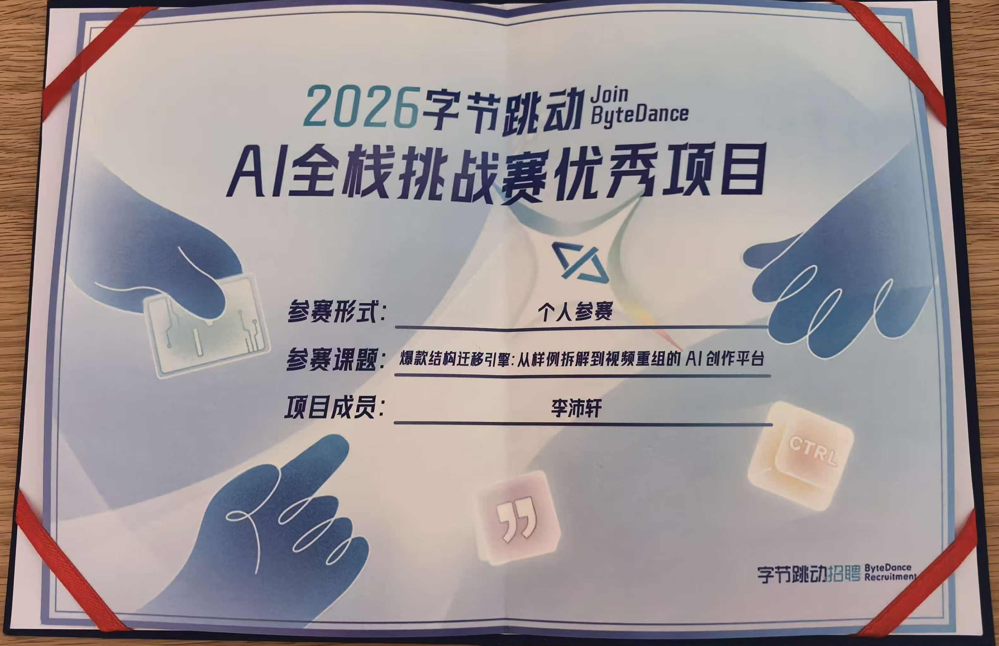
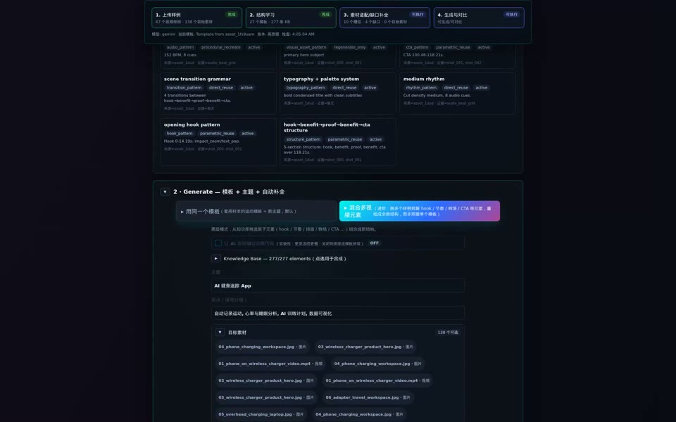
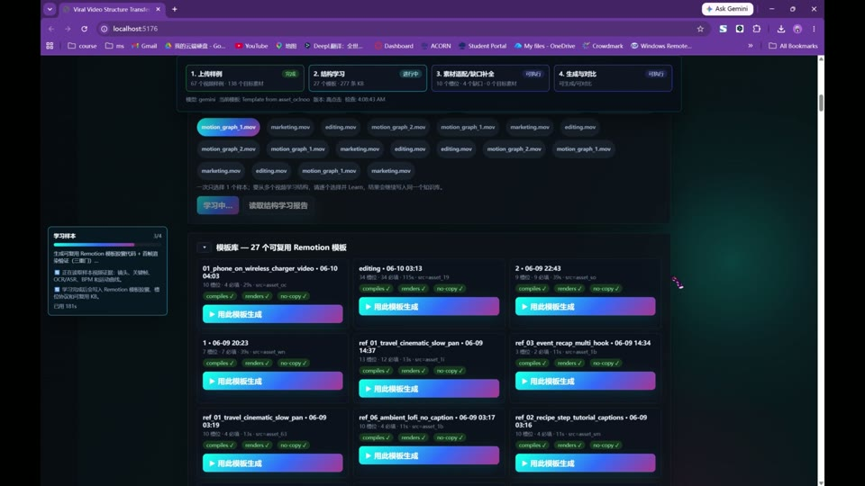
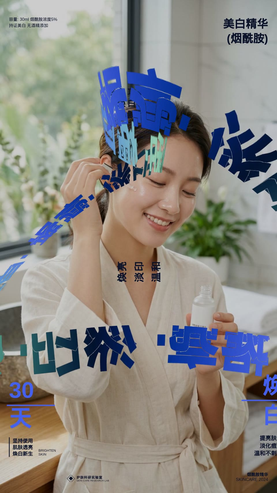
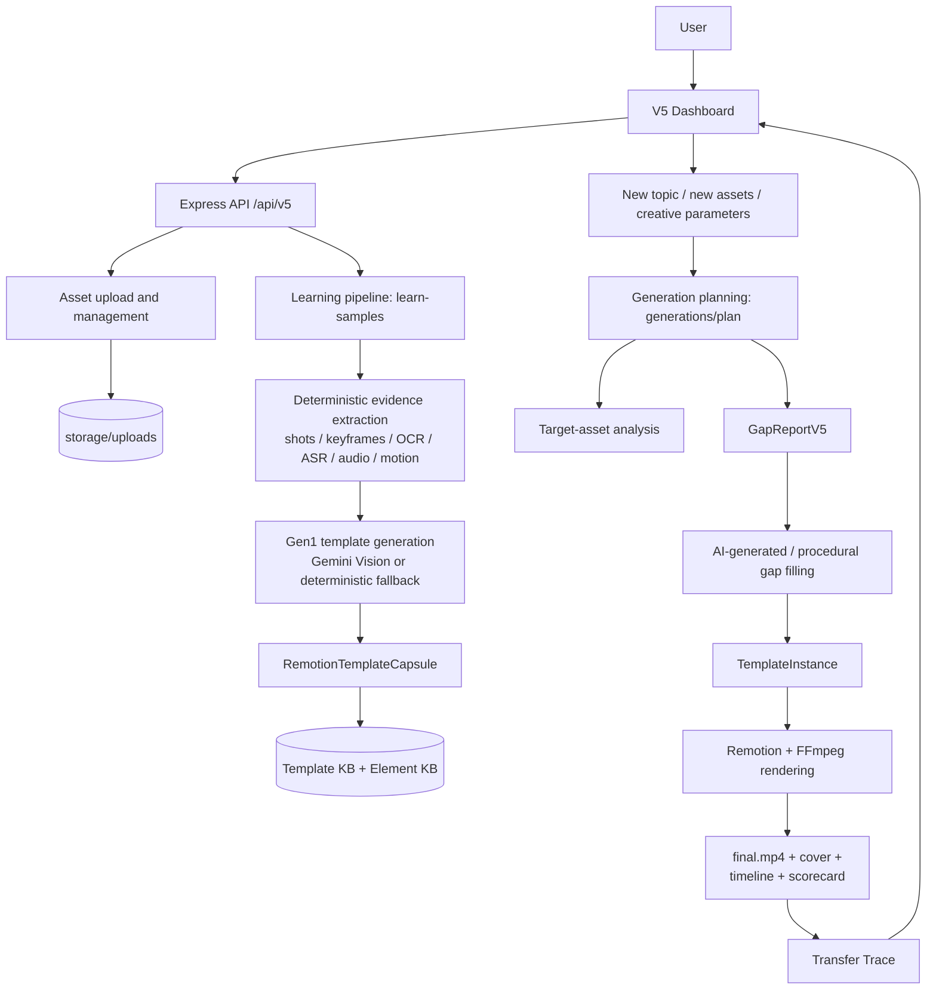

# Viral Video Structure Transfer Engine

**An AI creation platform for reference analysis, material completion, and video recomposition.**

Upload a reference video and a new topic or new materials. The engine learns the reference's pacing, shots, layout, subtitles, transitions, and audio structure, then transfers that creative structure to new content and renders a playable video.

Built by **Peixuan Li** for the **AI Full-Stack Challenge**. The current product workflow is **V5.1: same-template reconstruction**.

> 🏅 **Excellent Project Award — 2026 ByteDance AI Full-Stack Project Challenge**
>
> Awarded to **Peixuan Li (李沛轩)** for this project as an **individual entrant**.

This README includes the competition project description in English, its architecture diagram, supporting media, and additional implementation/setup guidance. Historical claims are clarified where the current code differs.

## Competition recognition

This project received the **Excellent Project Award** (优秀项目奖) in the **2026 ByteDance AI Full-Stack Project Challenge**. The organizers' results announcement names **Peixuan Li (李沛轩)** as the individual award recipient under the challenge topic **“Viral Video Structure Transfer Engine: An AI Creation Platform from Reference Analysis to Video Recomposition.”**

The announcement states that project development, presentation/defense review, and final result confirmation were completed before the awards were announced. It describes the evaluation in terms of technical implementation, engineering delivery, and innovative exploration.

Relevant award entry, translated from the announcement:

> **Excellent Project Award**
>
> Participation: Individual · Team: None · Participant: Peixuan Li
>
> Award benefits: fast-track interview opportunity, official award certificate, and 7 days of TRAE PRO membership.

Source: the organizers' award-results announcement signed **ByteDance Campus Recruitment**, supplied by the author as a Chinese screenshot.

### Excellent Project Award certificate

The certificate below recognizes this submission as an **Excellent Project** in the **2026 ByteDance AI Full-Stack Challenge**. It names **Peixuan Li (李沛轩)** as the project member, records individual participation, and identifies the Viral Video Structure Transfer Engine challenge topic.

[](docs/media/excellent-project-award.jpg)

[View the original award certificate](docs/media/excellent-project-award.jpg).

## Demo videos

### Product walkthroughs

| V5 dashboard walkthrough | Project walkthrough |
| --- | --- |
| [](https://youtu.be/VW6gEjYOQBI) | [](https://youtu.be/8X0cOFVYbG0) |
| Upload, learn, inspect templates, and generate new content. **8:16 · 2.5× recording.** | Competition project demonstration. **7:56.** |
| **[Watch on YouTube](https://youtu.be/VW6gEjYOQBI)** | **[Watch on YouTube](https://youtu.be/8X0cOFVYbG0)** |

### Generated videos

| Skincare product campaign | AI bookkeeping app |
| --- | --- |
| [](docs/media/generated-example-1.mp4) | [](docs/media/generated-example-2.mp4) |
| [Watch MP4](docs/media/generated-example-1.mp4) · 18 seconds | [Watch MP4](docs/media/generated-example-2.mp4) · 31 seconds |

These are compact 720p viewing copies of the competition outputs, with their full duration and audio. Their on-screen copy is in Chinese. The full walkthrough recordings are hosted on YouTube; their thumbnails are included in the repository.

## Contents

- [Competition recognition](#competition-recognition)
- [Demo videos](#demo-videos)
- [1. Project information](#1-project-information)
- [2. Challenge objectives and project approach](#2-challenge-objectives-and-project-approach)
- [3. Feature completion overview](#3-feature-completion-overview)
- [4. AI architecture](#4-ai-architecture)
- [5. Core data structures and structure protocol](#5-core-data-structures-and-structure-protocol)
- [6. Tool protocols](#6-tool-protocols)
- [7. Safety boundaries](#7-safety-boundaries)
- [8. Running the project](#8-running-the-project)
- [9. Models and fallbacks](#9-models-and-fallbacks)
- [10. Outputs and verification](#10-outputs-and-verification)
- [11. Repository map and documentation](#11-repository-map-and-documentation)

## 1. Project information

| Item | Details |
| --- | --- |
| Project name | Viral Video Structure Transfer Engine |
| Author | Peixuan Li |
| Award | **Excellent Project Award**, 2026 ByteDance AI Full-Stack Project Challenge; individual entrant, listed as 李沛轩 in the organizers' announcement. |
| Competition / challenge | AI Full-Stack Challenge / Engineering Bootcamp: Viral Video Structure Transfer Engine — an AI creation platform from reference analysis and material completion to video recomposition. |
| Summary | Input a viral short-video reference and a new topic/new materials. The system learns its pacing, shots, layout, subtitles, transitions, and audio structure, then transfers that creative structure to new content to produce a playable video. |
| GitHub repository | [Pxli9130/viral-video-structure-transfer](https://github.com/Pxli9130/viral-video-structure-transfer) |
| Screen recordings | [V5 Dashboard Demo, 2.5× speed](https://youtu.be/VW6gEjYOQBI) · [Competition Project Demo](https://youtu.be/8X0cOFVYbG0) |
| Main output videos | [Skincare campaign](docs/media/generated-example-1.mp4), based on the submission's `final.mp4` · [AI bookkeeping app campaign](docs/media/generated-example-2.mp4), based on `final 1.mp4`. These were generated by learning references supplied with the challenge. |
| Challenge reference | [Engineering Bootcamp challenge brief](https://bytedance.larkoffice.com/wiki/Rghtwq1VqiH4mkkOwyWc8v5lnhf#share-TH8Sdr8wBovQHmxOLrjcPoPAnec); access may require the competition workspace. |
| UI screenshots | [Dashboard capture 644 — PDF](docs/media/dashboard-capture-644.pdf) · [Dashboard capture 643 — PDF](docs/media/dashboard-capture-643.pdf). These preserve the original submission captures, including Chinese UI labels. |

Technology stack:

- **Frontend:** React 19, Vite, and TypeScript; the main interface is the V5 Dashboard.
- **Backend:** Node.js, Express, TypeScript, Multer, and JSON artifact storage. The main application store also supports SQLite.
- **Video generation:** Remotion and FFmpeg, with local Remotion rendering. The submission describes a Remotion Lambda-compatible composition structure; the documented runtime here uses local rendering rather than requiring a Lambda deployment.
- **Visual/audio analysis:** Python, OpenCV, PySceneDetect, librosa, OCR, ASR, ffprobe, and FFmpeg.
- **AI adapters:** Gemini text/vision/code generation/image completion, Doubao text models, Seedance 2.0, happyhorse reference-to-video, Google Lyria, and procedural audio fallback.
- **Shared protocols:** TypeScript contracts and runtime schemas under `packages/shared/src/contracts-v5/`. The submission uses the term “TypeScript/Zod contracts”; the shared V5 implementation currently uses TypeScript plus JSON Schema/AJV validation, with Zod available in code-generation validation paths.

## 2. Challenge objectives and project approach

The challenge addresses the difficulty of reusing a successful video's underlying creative structure. Manually deconstructing a short video requires understanding its opening hook, shot segmentation, subtitle density, beat points, transitions, product exposure, CTA, and musical mood, then mapping those choices to a new topic and new assets. This is labor-intensive and difficult to reproduce consistently.

The project separates video creation into structure learning and transfer generation, supported by knowledge storage and content-reuse boundaries:

1. **Learning:** Upload a reference video. Extract deterministic evidence, including shots, keyframes, visible text, speech, audio rhythm, motion intensity, and visual composition. Combine that evidence with the reference video for Gen1 reconstruction when configured, or use a deterministic fallback to create a neutral Remotion template capsule.
2. **Knowledge:** Store reusable structure in two levels. Level 1 contains full `RemotionTemplateCapsule` templates. Level 2 contains atomic knowledge elements such as hooks, rhythm, typography, transitions, CTA patterns, asset recipes, and audio recipes, derived from the reconstruction, its Remotion code/manifest, and optional model-produced elements.
3. **Generation:** Provide a new topic, selling points, and user materials. Select templates or structural elements, analyze target materials, create a gap report, fill missing images/video/copy/audio, and render with Remotion.
4. **Safety:** Use references as structural evidence. The intended final-output boundary excludes the reference's raw pixels, audio, subtitles, branding, people, and product materials.

The default V5.1 mode is `same_template`: reconstruct a reference as a parameterized template and bind new topics, materials, copy, and audio to its slots. The advanced `mix_elements` mode combines structural elements from multiple references; revisions use `modify_template` internally. Automatic gap filling defaults to `aigcGapFill.mode=auto_on`.

For example, a motion-poster reference can become a launch video for a new product while retaining its title hierarchy, ribbon animation, reveal sequence, and closing CTA timing. Its visual content and copy are replaced by target content.

### Applications

- Animated marketing posters and e-commerce product-discovery videos.
- Fast-cut edits, beat-synchronized videos, and event recaps.
- Motion graphics, step-by-step tutorials, and information explainers.
- Structural selection and style arbitration across multiple reference videos.
- Automatic material-gap detection and AI completion when user materials are insufficient.

### Core contributions

- `EvidenceTimelineV5` makes video understanding structured and timestamped, beyond a natural-language summary.
- `RemotionTemplateCapsule` represents transferable structure and distinguishes reusable creative decisions from content that must be replaced.
- Material matching, gap detection, AI completion, and rendering form one traceable pipeline.
- Results retain review evidence such as `transfer-trace`, `gap-report`, `material-analysis`, `timeline-v2`, `mapping-v2`, and `scorecard`.
- Multiple variants, natural-language changes, transfer visualization, and no-copy checks support review and iteration.

Output fidelity depends on the reference, target-material coverage, selected models, and render validation. A runnable fallback can have lower visual richness than the configured cloud path.

## 3. Feature completion overview

“Implemented” identifies an existing code/API/UI path. Cloud features require usable credentials and relevant options; optional analysis and local review bundles also depend on the environment.

| Feature | Status | Main code / page / API | Description |
| --- | --- | --- | --- |
| Reference input and parsing | Implemented | `POST /api/projects/:projectId/assets`, `POST /api/v5/learn-samples`, `runEvidenceV5.ts`, `analyze-evidence-timeline.py` | Upload video, images, audio, and text. Video analysis supports shots, keyframes, OCR/ASR, audio, and motion evidence; text/speech coverage depends on the analysis path and adapters. |
| Reference structure decomposition | Implemented | `EvidenceTimelineV5`, `NeutralReconstructionProgram`, `RemotionTemplateCapsule`, `runGen1CapsuleGemini.ts` | Decompose timing, shot roles, motion, subtitles, layout, audio, and replaceable slots. Optional Gemini visual codegen produces an AI template; deterministic reconstruction provides a local fallback. |
| New content and material input | Implemented | V5 Dashboard, `POST /api/projects/:projectId/assets`, `GET /api/v5/assets/:id/media` | Enter topics/selling points, upload target materials, and bind specific materials to template slots. |
| Structure transfer and generation | Implemented | `runSameTemplateGeneration.ts`, `renderTemplateCapsule.ts`, `POST /api/v5/generations` | Default `same_template` binds new content to the learned structure and renders an MP4 through Remotion. |
| Material-gap detection | Implemented | `runGapReportV5.ts`, `gap-report.json` | Record per-slot decisions such as `asset_reuse`, `weak_match`, `missing`, `aigc_fill`, and `text_fill`. |
| Material completion | Implemented | `aigcMaterialProviders.ts`, `googleAudio.ts`, `runSameTemplateGeneration.ts` | Gemini images, Seedance/happyhorse footage, Google TTS/Lyria, and procedural image/audio fallbacks. Cloud completion depends on external-service configuration. |
| Transfer-process visualization | Implemented | `GET /api/v5/generations/:id/transfer-trace`, dashboard trace panels | Show source evidence, template, target brief, material analysis, slot mappings, gaps, fill actions, edit history, and scores. |
| Review Evidence Center | Implemented | Dashboard: Showcase / Learn Analysis / Structure Protocol / Gap Decisions / Transfer Map / Packaging / Export | Show transfer/packaging plans and exportable drafts before generation; populate actual trace, timeline, mapping, scorecard, and packaging afterward. |
| Verifiable results | Implemented | `scorecard.json`, `similarity-report.json`, `runNoCopyScan.ts`, local `test_runs/v2_20260609-031151/` | MP4s, scores, similarity/no-copy reports, timelines, and mapping files. The submission includes a V2 review bundle and proof sheet; these generated artifacts are local. |
| Visual packaging | Implemented | `packaging-plan.json`, local `verify_submission/02_outputs/cover.png`, `storyboard.md` | Cover frames, title bars, version packaging, and storyboard artifacts in the relevant export/demo paths. |
| Multiple variants | Implemented | Dashboard variants, `variantStrategy`, review case `TC-V2-07` | Includes `high_click`, `high_conversion`, and `high_quality` strategies. |
| Real-material understanding | Implemented | `runTargetAssetAnalysis.ts`, `material-analysis.json` | Deterministic profiles with optional Gemini VLM enrichment; external analysis needs its switch and key. |
| Manual adjustment | Implemented | `POST /api/v5/generations/:id/revise` | Structured patches change theme, copy, palette, and creative parameters. |
| Natural-language editing | Implemented | `POST /api/v5/generations/:id/revise-natural-language`, review case `TC-V2-08` | Convert instructions into `TemplatePatchSet`, such as frontloading feature information or reducing subtitle density; record edit trace. |
| Multi-reference structure selection | Implemented | `referenceCapsuleIds`, `structureArbitration`, review cases `TC-V2-01/02` | Multiple template candidates, arbitration records, and cross-reference transfer. |
| Unified tool-registry approach | Implemented through adapters/modules | Backend adapters, pipeline modules, shared contracts | The submission's “ToolRegistry” refers to an engineering integration pattern: typed tools, runtime validation, static scanning, and render gates, rather than unrestricted model-driven execution. |

## 4. AI architecture

The architecture has a frontend workbench, API orchestration layer, AI/tool adapters, shared protocol layer, and artifact storage layer.

### Architecture diagram

The following is the English Mermaid reconstruction of the architecture diagram in the competition submission, preserving its upload/learning branch, generation branch, and feedback loop.



[Editable Mermaid source](docs/diagrams/submission-architecture.mmd) · [Rendered SVG](docs/diagrams/submission-architecture.svg)

The diagram is a conceptual overview. Actual uploads use `/api/projects/:projectId/assets`; the V5 routes are mounted under `/api/v5`. The `/generations/plan` endpoint skips final rendering; `/generations` runs the rendering path. Target analysis and stored knowledge feed the generation orchestration even where the original diagram shows separate branches.

### AI invocation

- **Text models:** `createTextModelFn` prefers a valid Ark/Doubao configuration, otherwise Gemini. It handles topic/context rewriting, copy generation, and natural-language instructions converted to patches.
- **Vision models:** `createGeminiVisionCodegenFn` understands the reference clip and generates its capsule. `runTargetAssetAnalysis.ts` can optionally use a VLM for user materials.
- **Image/video generation:** `aigcMaterialProviders.ts` wraps Gemini Image, Seedance 2.0, happyhorse reference-to-video, Seedream, and local deterministic filling.
- **Audio:** `googleAudio.ts` supports Google TTS/Lyria; rendering also supports procedural audio fallback.
- **Traditional analysis:** ffprobe/FFmpeg, OpenCV, PySceneDetect, librosa, OCR, and ASR provide deterministic evidence and optional text/speech analysis.

### State, storage, and rendering

- Uploaded assets live in `storage/uploads/<projectId>/`.
- Generated artifacts live in `storage/generated/`. V5 learning artifacts live in `storage/generated/v5/learn/<assetId>/`.
- Each generation persists `template-instance.json`, `final-video-program.json`, `gap-report.json`, `scorecard.json`, `material-analysis.json`, `timeline-v2.json`, `mapping-v2.json`, and related reports. The submission also lists `transfer-trace.json`; the current API assembles the transfer trace on demand and the dashboard can export it as JSON.
- `renderTemplateCapsule.ts` manages rendering, concurrency, timeouts, and a retry on render failure.
- The API job system and legacy pipeline remain in `apps/api/src/server.ts`; the V5 submission workflow primarily uses `/api/v5`.

### Pipeline details

1. **Learn:** Local video evidence grounds optional multimodal Gen1 reconstruction. A deterministic capsule remains available when the AI path is unavailable or fails.
2. **Store:** Save the capsule, replaceable slots, scene/audio recipes, knowledge manifest, and curated elements with source evidence.
3. **Transfer:** Analyze target assets, bind compatible materials, rewrite content for the new topic, and resolve gaps.
4. **Render and inspect:** Render the bound template with Remotion, process media/audio with FFmpeg, and expose quality/no-copy findings, the transfer trace, and readiness score.

Long references can be split at scene boundaries into chunks, reconstructed, and stitched into one multi-file capsule. The default chunk trigger is 34 seconds and the default chunk cap is 30 seconds. Model selection is separately configurable. The primary AI reconstruction path promotes code based on compilation and a real preview render, while recording other validation and fidelity findings.

## 5. Core data structures and structure protocol

The authoritative contracts live in [packages/shared/src/contracts-v5/](packages/shared/src/contracts-v5/). [CONTRACTS-CANONICAL.md](spec_v5/CONTRACTS-CANONICAL.md) explains the canonical-contract boundary; current code definitions take precedence over stale specification examples. Filenames below use the current repository locations where submission terminology differs.

| Challenge concept | Actual project contract | Location | Purpose |
| --- | --- | --- | --- |
| `SampleVideoAnalysis` | `EvidenceTimelineV5`; legacy `VideoAnalysisResult` | `contracts-v5/evidence.ts`, `apps/api/src/adapters/evidenceTimeline.ts` | Deterministic reference evidence: shots, keyframes, text, speech, musical rhythm, motion, and material policy. |
| `VideoStructure` | `NeutralReconstructionProgram`, `RemotionTemplateCapsule` | `contracts-v5/neutralProgram.ts`, `contracts-v5/templateCapsule.ts` | Abstract the reference into a neutral reconstruction program and reusable template capsule. |
| `StructureSlot` | `TemplateSlot`, `PlaceholderSlotV5`; legacy placeholder slots | `contracts-v5/templateCapsule.ts`, `contracts-v5/common.ts`, `contracts-v5/composition.ts` | Replaceable image/video, headline, subtitle, CTA, voiceover, and music slots. |
| `MaterialAsset` | `Asset`, `TargetAssetProfile` | `packages/shared/src/types.ts`, `contracts-v5/composition.ts`, `server.ts` | Uploaded target materials and their analysis profiles. |
| `GapReport` | `GapReportV5` | `contracts-v5/composition.ts`, `runGapReportV5.ts` | Identify matched, weakly matched, missing, and AI-fillable requirements. |
| `TimelineDraft` | `RenderRecipeV5`, `timeline-v2.json` | `contracts-v5/finalProgram.ts`, `runSameTemplateGeneration.ts` | Final timeline, segments, slot bindings, and render layers. |
| `Storyboard` | `sceneRecipes`, knowledge manifest, exported `storyboard.json` | `templateCapsule.ts`; local `verify_submission/02_outputs/storyboard.json` | Readable shot segments, transitions, subtitle behavior, and visual actions. |
| `PackagingPlan` | `packaging-plan.json` | `runSameTemplateGeneration.ts`, `v2Reports.ts` | Cover, title bars, variant packaging, and presentation metadata. |
| `RenderJob` | `FinalVideoProgram`; legacy `RenderOutput` | `contracts-v5/finalProgram.ts`, `renderTemplateCapsule.ts`, `renderV5.ts` | Render execution, output files, scorecards, and quality gates. |

Related contracts include `KnowledgeElement` for reusable creative units, `TemplateInstance` for newly bound props/assets, `TemplatePatchSet` for revisions, and `ScorecardV5` for evaluation.

### Simplified structure-protocol example

This is the submission's explanatory example translated into English. It illustrates the relationship between template structure, slots, gap decisions, and new content; it is a shortened conceptual object rather than a complete canonical API payload. In full contracts, timing, scene recipes, and instance fields have their defined typed representations.

```json
{
  "templateCapsule": {
    "id": "capsule_sample_marketing_001",
    "sourceSampleId": "asset_reference_video",
    "durationSec": 12,
    "sceneRecipes": [
      {
        "id": "cold_open",
        "role": "hook",
        "startSec": 0,
        "endSec": 2.2,
        "visualIntent": "strong product reveal",
        "motionIntent": "fast scale-in with title overlay"
      }
    ],
    "slotSchema": [
      {
        "id": "hero_product",
        "kind": "product_image",
        "required": true,
        "replacementPolicy": "user_asset",
        "mediaKind": "image",
        "timing": { "startSec": 0, "endSec": 12 }
      },
      {
        "id": "main_headline",
        "kind": "headline",
        "required": true,
        "replacementPolicy": "text_generate",
        "timing": { "startSec": 0.2, "endSec": 2.4 }
      }
    ],
    "safety": {
      "samplePixelsReusable": false,
      "sampleAudioReusable": false,
      "sampleTextReusable": false
    }
  },
  "gapReport": {
    "slots": [
      {
        "slotId": "hero_product",
        "status": "matched",
        "action": "asset_reuse",
        "assetId": "asset_user_packshot"
      },
      {
        "slotId": "background_broll",
        "status": "missing",
        "action": "aigc_fill"
      }
    ]
  },
  "templateInstance": {
    "generationMode": "same_template",
    "targetTheme": "Eye-friendly desk lamp",
    "propsBinding": {
      "hero_product": "/api/v5/assets/asset_user_packshot/media",
      "main_headline": "Stay focused with comfortable, glare-free light"
    }
  }
}
```

## 6. Tool protocols

Backend adapters, pipeline modules, and shared contracts form the project's tool-integration system. Inputs and outputs are constrained through TypeScript types, runtime schemas, Zod where used by code-generation components, runtime checks, path policies, static scanning, and real render gates.

| Tool / capability | Main entry | Input | Output | Safety / validation |
| --- | --- | --- | --- | --- |
| Asset upload and retrieval | `server.ts`, `POST /api/projects/:projectId/assets`, `GET /api/v5/assets/:id/media` | Multipart file, project ID | `Asset` record, stable managed path, media URL | MIME/extension allowlists, 500 MiB limit, managed uploads under `storage/uploads`. |
| Video evidence extraction | `analyzeEvidenceTimeline`, `scripts/analyze-evidence-timeline.py` | Local video path | Shots, keyframes, OCR/ASR where enabled, audio, motion | Python launches with an argument array; output is mapped to `EvidenceTimelineV5`. |
| OCR / ASR | `scripts/python/ocr_easyocr.py`, `scripts/python/asr_faster_whisper.py` | Keyframes / audio | Visible-text and speech evidence | Evidence informs structure; reference subtitles/voices are outside the reusable-content boundary. |
| Gen1 visual template generation | `runGen1CapsuleGemini.ts`, `gen1ModelFactory.ts` | Reference video, deterministic evidence, prompt | `RemotionTemplateCapsule`, slot schema, asset plan, knowledge elements | TypeScript parsing, prohibited-API/sample-path checks, compilation, and real preview rendering. Inspect all recorded validation findings. |
| Context rewriting / copy / natural-language edits | `createTextModelFn`, `runCapsuleContextRewrite.ts`, `revise-natural-language` | Topic, selling points, slots, user instruction | New copy, palette, `TemplatePatchSet` | Available text model with deterministic fallback handling; backend interprets constrained patches. |
| Target-material analysis | `runTargetAssetAnalysis.ts` | User images / video / audio | `TargetAssetProfile`, quality scores, highlights, tags | External VLM needs its enable switch; heuristic/local analysis is available. |
| Gap detection | `runGapReportV5.ts` | Slots, target profiles | `GapReportV5` | Explicit matched/weak-match/missing/fill decisions. |
| Timeline / composition planning | `runCompositionPlanner.ts`, `runCreateV5.ts`, `runSameTemplateGeneration.ts` | Templates, brief, materials, gaps | Composition, timeline, mapping, template instance | V5.1 defaults to the same-template capsule rendering path. |
| AI material completion | `aigcMaterialProviders.ts` | Slot brief, target topic, privacy policy | Generated image/video asset | External-provider call context and provenance; same-template generation briefs exclude reference frames. |
| Audio / TTS / music | `googleAudio.ts`, `renderV5.ts`, `renderTemplateCapsule.ts` | Voiceover / music brief | Generated or procedural audio | Optional cloud services; procedural fallback where supported. |
| Rendering | `renderTemplateCapsule.ts`; legacy `renderV5.ts` | Remotion code, props, audio | MP4, poster/still, render metadata | Remotion bundle/render, FFmpeg muxing, timeout, concurrency cap, retry. |
| No-copy scanning and scoring | `runNoCopyScan.ts`, `runScorecardV5.ts` | Final video, source evidence, artifacts | No-copy report, scorecard | Perceptual frame/audio comparison when invoked and available; structural provenance/warnings otherwise. The AI-capsule path currently skips perceptual scanning by policy. |

## 7. Safety boundaries

### 7.1 Keys and environment variables

- External-model credentials are read from `.env` and the process environment. Keep real keys out of documentation and version control.
- `.env.example` documents Gemini, Ark/Doubao, Seedance, Google audio, and other variables using blank credential values. Its switches are configured for a cloud-capable demo.
- Error/report paths include redaction for sensitive fields such as Google API keys; inspect exported evidence before publishing it.
- Cloud generation and VLM capabilities are optional. Without usable credentials, relevant paths use deterministic/procedural fallback or report missing capability.

### 7.2 Files and materials

- Multer stages uploads under `storage/uploads/tmp`, then stores them under `storage/uploads/<projectId>/`.
- Uploads have size and MIME/extension checks.
- `resolveTargetAssetPath` resolves managed storage locations and a small set of fixture paths rather than accepting arbitrary local files through public material-manifest inputs.
- Managed target manifests reject unsupported external paths and URLs during material resolution.
- Generated outputs live under `storage/generated/`, separately from source materials.

### 7.3 Tool execution

- Python, FFmpeg, and ffprobe are launched through process wrappers using argument arrays; model output is not directly concatenated into shell commands.
- Backend wrappers execute rendering; models do not receive a general system-command interface.
- Remotion rendering has concurrency and timeout controls.
- Static scans check for prohibited runtime capabilities such as `require`, `process`, `child_process`, `fs`, `eval`, `fetch`, `XMLHttpRequest`, and dynamic imports.

### 7.4 Prompt injection and model-output handling

- Gen1 output passes through parsing, import/API checks where implemented, sample-path scans, and real still/render checks. Compilation and preview rendering determine promotion in the primary AI path; other findings remain part of the validation evidence.
- `validateTemplateCapsule.ts` checks sample paths, remote URLs, long hardcoded strings, canvas/3D text literals, and unsafe runtime APIs.
- Template and generation gates cover template existence, compilability, declared slots, source-reuse policy, final MP4 availability, motion, and related quality evidence.
- Natural-language editing produces a `TemplatePatchSet` that the backend interprets, rather than arbitrary file-edit instructions.
- Static scans and a successful render are separate checks; they do not provide a general isolation guarantee for arbitrary code. Inspect the recorded gate results and warnings.

### 7.5 Copyright and no-copy boundary

- **Transferable:** Remotion component structure, timeline, layout, animation curves, typography behavior, transition sequencing, audio cue positions, and slot schema.
- **Replaced in new content:** Original reference images/pixels, video frames, audio, subtitles, logos, watermarks, branding, people, and product materials.
- Final videos bind user-provided, generated, or procedural materials and new copy to the learned template.
- `runNoCopyScan.ts` can compare perceptual frame hashes and audio similarity when invoked with the necessary tools and media.
- The current same-template AI-capsule path skips perceptual scanning by policy and reports structural provenance. Other paths can fall back to structural no-copy when scanning is unavailable or fails. Inspect the details instead of treating that result as an executed perceptual comparison.

### 7.6 Privacy and external calls

- A configured local workflow can extract evidence, build fallback templates, and fill gaps procedurally.
- When external visual reconstruction is enabled, the reference video/frames can be sent to Gemini for Gen1. User-material VLM enrichment has a separate explicit switch.
- Provider provenance records external generation and its media policy. Same-template AIGC briefs exclude reference frames and user-material references; happyhorse uses a newly generated reference still.
- Before publishing review artifacts, confirm `.env` is excluded and demonstrations do not expose sensitive materials.
- External understanding and external generation are distinct paths. Disabling one flag does not necessarily disable every V5 text, vision, and generation factory; use the local setup below when that behavior is required.

## 8. Running the project

### 8.1 Environment preparation

Use Node.js 22 and the configured Python/Conda environment. FFmpeg/ffprobe and Python video-analysis packages are required for learning; Chromium is required for real Remotion rendering. A first render may download a browser.

If these locations match your installation, the submission's toolchain example is:

```bash
export PATH="$HOME/.nvm/versions/node/v22.20.0/bin:$HOME/anaconda3/envs/viral/bin:$PATH"
export CONDA_BASE="$HOME/anaconda3"
export VIRAL_CONDA_ENV="viral"
```

Adjust the paths for your machine. The API's evidence adapter currently checks for `<CONDA_BASE>/envs/<VIRAL_CONDA_ENV>/bin/python`; `python3` on PATH alone does not satisfy that precondition.

To create an environment if needed:

```bash
conda create -n viral -c conda-forge python=3.11 ffmpeg
conda activate viral
python -m pip install numpy opencv-python scenedetect librosa

# Optional local OCR and ASR
python -m pip install easyocr faster-whisper
```

Install Node dependencies and configure providers:

```bash
npm install
cp .env.example .env
# Fill Gemini, Ark/Doubao, Seedance, Google audio, or other credentials as needed.
# Without cloud services, deterministic/procedural fallbacks have lower visual richness.
```

Set `CONDA_BASE` in `.env` to your Conda installation (`conda info --base`) and `VIRAL_CONDA_ENV` to the environment name. Keep workspace dependency versions and the lockfile aligned, particularly Remotion, React, Three.js, and React Three Fiber.

The local workflow needs Node, the Conda/Python analysis environment, FFmpeg, and a usable browser for rendering. For the full AI demo, Gemini is useful because reference understanding, Gen1 reconstruction, text rewriting, and image completion can share `GEMINI_API_KEY`.

### API and model configuration by capability

These model IDs reproduce the submission/repository configuration. They are configurable and depend on access available to your provider account.

| No. | Capability | Required / suggested API and environment variables | Purpose |
| --- | --- | --- | --- |
| 1 | Reference VLM understanding / Gen1 structure learning | `GEMINI_API_KEY`, `VLM_PROVIDER=gemini`, `VLM_MODEL=gemini-3.5-flash`, `ALLOW_EXTERNAL_VLM_SAMPLE_ANALYSIS=1`, `ALLOW_EXTERNAL_SAMPLE_MEDIA=1` | Reference interpretation, shot semantics, structural sections, subtitle packaging, and motion rhythm. Deterministic evidence/fallback templates remain available without the key. |
| 2 | Text LLM / context rewriting / natural-language editing | `GEMINI_API_KEY`, `AI_PROVIDER=gemini`, `AI_GEMINI_MODEL=gemini-3.5-flash`; alternatively `AI_PROVIDER=ark_doubao`, `ARK_API_KEY`, `ARK_MODEL` | Topic rewriting, selling-point copy, edit planning, score explanations in supported paths, and context rewriting. V5's text factory has the Ark-first priority described below. |
| 3 | Remotion capsules / AI-written animation | `GEMINI_API_KEY`, `GEMINI_CODEGEN_MODEL=gemini-3.5-flash`, `GEMINI_GEN1_MODEL=gemini-3.1-pro-preview`, `GEMINI_GEN1_MODEL_LONG=gemini-3.1-pro-preview` | Reusable reference-derived templates and the advanced Generate option to write animation code. |
| 4 | Target-material VLM enrichment | `GEMINI_API_KEY`, `ALLOW_EXTERNAL_VLM_USER_ASSET_ANALYSIS=1`, `AIGC_ALLOW_TARGET_ASSETS_TO_PROVIDER=true` | Subject/scene understanding, quality, suggested slots, and highlights. Check the actual route's VLM enable switch; local profiles are available. |
| 5 | AI image completion | `GEMINI_API_KEY`, `AIGC_MATERIAL_FILL_ENABLED=true`, `AIGC_IMAGE_PROVIDER=google_gemini_image`, `GEMINI_IMAGE_MODEL=gemini-3.1-flash-image` | Product, background, atmosphere, and packaging images for missing slots. |
| 6 | Seedream image backup | `SEEDREAM_ARK_API_KEY`, `SEEDREAM_ARK_BASE_URL`, `SEEDREAM_ARK_MODEL=doubao-seedream-5-0-260128` | Alternate image provider when configured by the caller; backup ordering varies by pipeline. |
| 7 | AI video completion | `AIGC_VIDEO_PROVIDER=seedance_2_0`, `AIGC_VIDEO_FILL=1`, `SEEDANCE_MODEL=doubao-seedance-2-0-fast-260128`; one of `SEEDANCE_ARK_API_KEY`, `SEEDREAM_ARK_API_KEY`, or `ARK_API_KEY` | Missing moving footage, product motion, and b-roll. The same-template path selects Seedance directly for eligible video slots and also recognizes `SEEDANCE_API_KEY`. |
| 8 | Backup footage / reference-to-video | `DASHSCOPE_API_KEY`, `DASHSCOPE_BASE_URL=https://dashscope-us.aliyuncs.com/api/v1`, `AIGC_VIDEO_BACKUP_PROVIDER=happyhorse_r2v`, `HAPPYHORSE_MODEL=happyhorse-1.0-r2v` | Reference-still-to-video backup when Seedance is unavailable. Match the API region to the key. |
| 9 | TTS / music generation | `GEMINI_API_KEY`, `GOOGLE_AUDIO_ENABLE_CLOUD=1`, `GOOGLE_AUDIO_ENABLE_TTS=1`, `GOOGLE_AUDIO_ENABLE_MUSIC=1`, `GOOGLE_TTS_MODEL`, `GOOGLE_MUSIC_MODEL` | Narration, music beds, mood, and audio completion in supported paths; procedural audio fallback. |
| 10 | ASR / SFX / ElevenLabs audio | `ELEVENLABS_API_KEY`, `ASR_PROVIDER=elevenlabs_scribe`, `ELEVENLABS_ENABLE_SCRIBE=1`, `ELEVENLABS_ENABLE_TTS=1`, `ELEVENLABS_ENABLE_SFX=1` | Speech transcription, effects, TTS, and audio enhancement. Use local faster-whisper or skip cloud capabilities when unavailable. |
| 11 | Ark/Doubao text models | `AI_PROVIDER=ark_doubao`, `ARK_BASE_URL=https://ark.cn-beijing.volces.com/api/v3`, `ARK_API_KEY`, `ARK_MODEL` | Additional text-model route. V5 `createTextModelFn` prefers a configured Ark/Doubao endpoint before Gemini. |

For the complete cloud demonstration, the submission enables:

```dotenv
ALLOW_CLOUD_PROVIDERS=1
ALLOW_EXTERNAL_SAMPLE_MEDIA=1
ALLOW_EXTERNAL_VLM_SAMPLE_ANALYSIS=1
ALLOW_EXTERNAL_VLM_USER_ASSET_ANALYSIS=1
ALLOW_EXTERNAL_ASR_SAMPLE_ANALYSIS=1
AIGC_ALLOW_EXTERNAL_UPLOAD=true
AIGC_ALLOW_SAMPLE_FRAMES_TO_PROVIDER=true
AIGC_ALLOW_TARGET_ASSETS_TO_PROVIDER=true
```

For stricter privacy, the submission disables these external sample/material paths:

```dotenv
ALLOW_EXTERNAL_SAMPLE_MEDIA=0
ALLOW_EXTERNAL_VLM_SAMPLE_ANALYSIS=0
ALLOW_EXTERNAL_VLM_USER_ASSET_ANALYSIS=0
AIGC_ALLOW_SAMPLE_FRAMES_TO_PROVIDER=false
AIGC_ALLOW_TARGET_ASSETS_TO_PROVIDER=false
```

**For an explicitly local workflow**, also leave cloud credentials empty, disable the remaining cloud/audio flags, disable model-based capsule codegen/context rewriting, and select procedural filling in requests. The [local configuration guide](docs/development.md#local-configuration) contains the full environment and request examples. The supplied `.env.example` enables cloud features and external sample analysis; a single environment flag does not disable all V5 calls.

### 8.2 Start the development environment

Start the web app and API together:

```bash
conda activate viral
npm run dev
```

Or run them in separate terminals after building their shared dependencies:

```bash
npm run build --workspace @vvst/shared
npm run build --workspace @vvst/renderer

# Terminal 1
npm run dev:api

# Terminal 2
npm run dev:web
```

Default addresses:

- **V5 Dashboard:** [http://localhost:5173/#v5](http://localhost:5173/#v5). V5 is also the default hashless page. If port 5173 is occupied, Vite may use 5174 or another port; use its printed URL and append `/#v5`.
- **API status:** [http://localhost:3000/](http://localhost:3000/).
- **API health:** [http://localhost:3000/healthz](http://localhost:3000/healthz); readiness: `/readyz`.
- **V5 API:** `http://localhost:3000/api/v5`.
- **Legacy interface:** `http://localhost:5173/#v4`.

If you change `APP_PORT`, also update the web proxy in `apps/web/vite.config.ts`, which currently targets port 3000.

### 8.3 V5 dashboard workflow

Some dashboard labels remain in Chinese. The following translates the complete submission walkthrough:

1. Open the V5 Dashboard. Confirm the fixed status bar shows API readiness, asset/template counts, slot/gap status, and generation status.
2. In **0 · Upload**, select a reference video and target images/videos. After selecting files, click the corresponding **Upload** button explicitly.
3. In **1 · Learn**, select a reference and click **Learn 1 Sample**, triggering `/api/v5/learn-samples`. Follow structure-learning progress in the left panel.
4. Open **Read Structure Learning Report** to inspect keyframes, the horizontal structure timeline, structure fingerprint, reusable/non-reusable boundaries, slot requirements, knowledge-base writes, and Remotion code insights.
5. Open the **Review Evidence Center** and inspect **Showcase → Learn Analysis → Structure Protocol → Gap Decisions → Transfer Map → Packaging → Export**. Transfer Map and Packaging show drafts before generation and actual trace information afterward.
6. Select a reusable Remotion template from the template library, or search/select structural atoms in the Knowledge Base.
7. In **2 · Generate**, use the default `same_template` mode. Target materials are collapsible and multi-selectable; use **Move Up / Move Down / Remove** to set order. The first compatible material is prioritized for the first compatible visual slot.
8. Check each slot's kind, matched asset, and gap strategy in the gap table. Upload and bind a specific asset to an individual slot when needed.
9. Choose the AI completion strategy, variant preset, and LLM rewriting requirements. Advanced `mix_elements` can mix multiple references and enable **Have AI write animation code on the fly**.
10. After generation, inspect `final.mp4`, slot bindings, gap report, timeline, mapping, packaging, scorecard, and no-copy evidence. Continue with structured patches or natural-language edits and re-render as needed.
11. In **Export**, download currently loaded evidence such as `template-capsule-v5.json`, `sample-evidence-v5.json`, `transfer-trace-v5.json`, `scorecard-v5.json`, and pre-generation transfer/packaging drafts.

Revisions reuse prior visuals for theme/copy/palette changes. Creative controls can trigger a template rewrite; regenerating images requires a fresh generation. Variant generation supports comparison across creative strategies.

## 9. Models and fallbacks

These are repository integrations, not guarantees of provider availability. Model IDs are configurable in [.env.example](.env.example).

| Task | Configured path | Fallback behavior |
| --- | --- | --- |
| Reference video/frame reconstruction | Gemini multimodal Gen1; long references can be split into scene-aware chunks. | Text-only code generation or deterministic capsule when the relevant path is unavailable or fails. |
| Topic rewriting, copy, edit planning | V5 `createTextModelFn` prefers a configured Ark/Doubao endpoint, then Gemini. | Deterministic content/patch handling; some rewrite paths also try Gemini after an Ark failure. |
| Missing images | Gemini Image; Seedream is available through provider adapters. | Procedural visuals with warnings; fallback ordering varies by pipeline. |
| Missing video footage | Seedance 2.0, then happyhorse reference-to-video using a newly generated still. | Generated still, then procedural fallback if needed. |
| Music and other audio | Same-template generation uses Google Lyria; Google TTS and ElevenLabs adapters exist for other audio paths. | Local FFmpeg/procedural audio where supported. |
| Evidence | Local FFmpeg/OpenCV/scene/audio analysis; OCR/ASR are optional adapters. | Reduced evidence and recorded warnings when optional analysis is unavailable. |

V5's text-model factory is separate from the legacy `AI_PROVIDER` adapter. Configuring an Ark key and model can give it priority even when `AI_PROVIDER=gemini`. See [provider configuration](docs/development.md#provider-configuration) for exact settings and route differences.

## 10. Outputs and verification

With the default `STORAGE_DIR=./storage`, runtime artifacts live in:

```text
storage/
  uploads/<projectId>/                 Uploaded reference and target media
  kb/knowledge-base.json              Template capsules, elements, curation decisions
  generated/v5/learn/<assetId>/        Evidence, reconstruction, capsule, learn gates
  generated/v5/generations/<genId>/    MP4 and generation evidence
```

A same-template generation writes `template-instance.json`, `final-video-program.json`, `gap-report.json`, `material-analysis.json`, `timeline-v2.json`, `mapping-v2.json`, `packaging-plan.json`, `similarity-report.json`, and `scorecard.json`. Rendered runs can also produce `final.mp4`, `cover.png`, quality reports, and no-copy scan results. Transfer traces are assembled at `GET /api/v5/generations/:id/transfer-trace` and exported from the UI.

The submission's local review material includes `test_runs/v2_20260609-031151/`, its test report/proof sheet, and `verify_submission/02_outputs/` with final video, cover, and storyboard artifacts. These paths describe locally generated evidence and may not exist in a fresh checkout.

Read the scorecard's `readinessLevel`, gates, warnings, and fallback provenance alongside the video. The readiness levels are `artifact_valid`, `technical_demo`, `review_demo`, and `shippable_demo`; an MP4 alone does not establish faithful reconstruction, complete material coverage, or review readiness. Inspect the no-copy details to distinguish perceptual comparison from structural provenance.

Core checks:

```bash
npm run validate:schemas:v5
npm run typecheck
npm test
```

The V5 schema validator currently has a separate registry assertion that expects 43 gates while the registry defines 44; the six example validations can pass while that assertion fails. See the [development guide](docs/development.md#troubleshooting).

Media regressions and real-provider demos need additional tools, authorized reference videos, and sometimes cloud credentials. See [verification and demos](docs/development.md#verification-and-demos). Apart from the curated README media, source videos, generated media, and review bundles are generally excluded from Git. A fresh checkout may have an empty runtime Showcase until artifacts are generated locally.

`scripts/record-v5-demo.mjs` records a UI walkthrough using Playwright and FFmpeg. The [recording guide](docs/development.md#record-a-ui-demo) explains its URL, operation switches, exports, and local configuration.

## 11. Repository map and documentation

```text
apps/web/                    React 19 / Vite dashboard
apps/api/src/v5Routes.ts      V5 HTTP API and orchestration wiring
apps/api/src/pipeline-v5/     Learning, binding, filling, rendering, evaluation
apps/api/src/services/       Knowledge-base and storage services
apps/api/src/adapters/       Text, vision, audio, local-tool adapters
apps/api/remotion/           Remotion compositions and render components
packages/shared/            Canonical contracts, schemas, engine, provider adapters
packages/renderer/          Browser-safe preview helpers
scripts/                    Analysis, demos, recording, evaluation, exports
spec_v5/                    V5/V5.1 specifications and examples
docs/diagrams/              English submission architecture: Mermaid + SVG
docs/media/                 Curated video previews, posters, screenshot PDFs
```

The application uses npm workspaces, Express 5, React/Vite, Remotion, FFmpeg, Python/OpenCV, JSON storage with optional SQLite for the main store, and Vitest. V5 knowledge-base and pipeline artifacts remain file-backed.

- [Project overview](docs/project-overview.md): companion architecture and evaluation overview.
- [Development guide](docs/development.md): full local/cloud setup, API examples, scripts, and troubleshooting.
- [English architecture Mermaid source](docs/diagrams/submission-architecture.mmd) and [SVG](docs/diagrams/submission-architecture.svg).
- [Demo media inventory](docs/media/README.md): source recordings, YouTube links, viewing-copy details, screenshot attachments.
- [V5 specification index](spec_v5/README.md) and [same-template mode](spec_v5/same-template-mode.md).
- [Canonical contracts](spec_v5/CONTRACTS-CANONICAL.md) and [TypeScript definitions](packages/shared/src/contracts-v5/).
- [Competition rubric mapping](spec_v5/rubric-alignment.md).

`specs_v1/`, `spec_v1_1/`, `spec_v2/`, `spec_v3/`, and `spec_v4/` preserve earlier designs and workflows. Specifications may include planned behavior; current code and canonical contracts take precedence when they differ.
