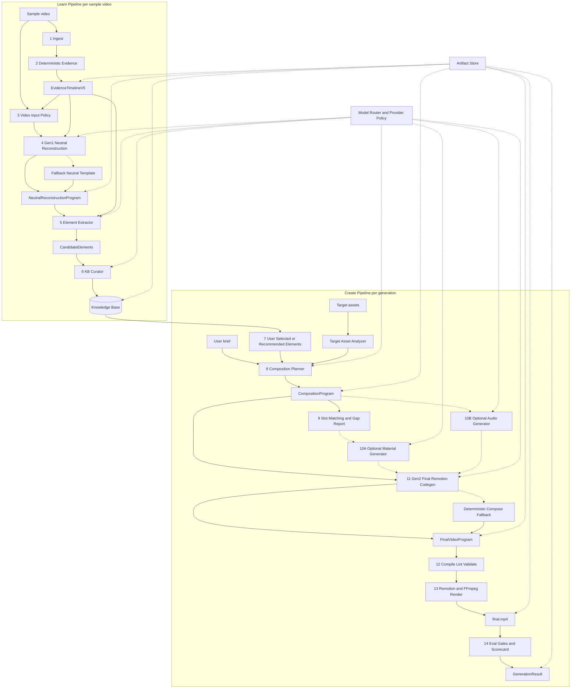
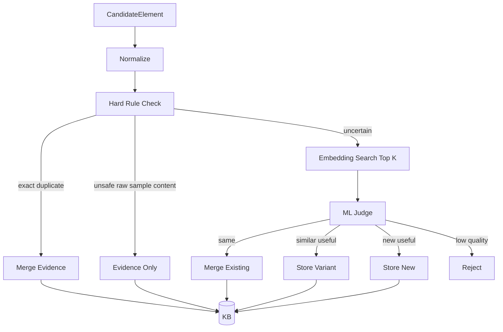

# Spec V5 Full Bundle
---

<!-- README.md -->

# Spec V5 — Program-KB Dual Codegen Creative Engine

V5 is a complete target architecture for the viral video structure transfer engine.
It replaces the V4 “evidence -> template/atoms -> recipe” mindset with a stronger two-stage system:

```text
Many sample videos
  -> deterministic evidence
  -> Gen1 neutral reconstruction program
  -> reusable knowledge elements
  -> Knowledge Base
  -> user selected elements + target assets + brief
  -> composition planner
  -> Gen2 final Remotion program
  -> render final.mp4
```

Core principle:

```text
Learn structure, not content.
Learn asset recipes, not raw sample pixels.
Learn music patterns, not raw sample audio.
```

## Package contents

- `00-executive-summary.md` — what V5 is and why it exists.
- `requirements.md` — functional, non-functional, and rubric requirements.
- `architecture.md` — system architecture and pipeline diagrams.
- `pipeline.md` — exact step-by-step pipeline behavior.
- `data-contracts.md` — TypeScript-style contracts.
- `knowledge-base.md` — KB element model, dedupe, curator, retrieval.
- `gen1-neutral-reconstruction.md` — sample-video-to-neutral-program spec.
- `gen2-final-composition.md` — selected-elements-to-final-code spec.
- `api.md` — HTTP API endpoints.
- `renderer-spec.md` — Remotion / FFmpeg render contracts.
- `ui-demo-spec.md` — demo UI and what to display for rubric.
- `acceptance-gates.md` — V5 quality/safety gates.
- `provider-policy.md` — model/provider policy and fallbacks.
- `model-stack.md` — recommended local/cloud model stack.
- `routing-and-fallbacks.md` — retry, fallback, and failure behavior.
- `security-and-safety.md` — no-copy, provenance, asset/audio policy.
- `implementation-delta.md` — how to migrate from V4 to V5.
- `tasks.md` — implementation task breakdown.
- `test-plan.md` — test cases and regression plan.
- `schemas/` — JSON Schema drafts for V5 objects.
- `examples/` — example artifacts.
- `prompts/` — prompt templates for Gen1, Gen2, curator, planner.
- `diagrams/v5_architecture.mmd` — Mermaid architecture diagram.
- `SPEC_V5_ALL.md` — all documents concatenated.

## V5 glossary

| Term | Meaning |
|---|---|
| EvidenceTimelineV5 | Deterministic timeline from FFmpeg/OpenCV/librosa/ASR/OCR. |
| Gen1 | AI synthesizer that converts a sample video + evidence into a neutral reconstruction program. |
| NeutralReconstructionProgram | Typed spec + Remotion preview code + placeholders + recipes + evidence refs. |
| KnowledgeElement | Reusable, content-neutral creative unit extracted from a sample. |
| KB Curator | Hard-rule + ML dedupe/store/merge/variant/reject pipeline. |
| CompositionProgram | JSON plan that combines selected KB elements into a new video structure. |
| Gen2 | AI code generator that creates final Remotion code from selected elements and composition plan. |
| FinalVideoProgram | Final Remotion project + RenderRecipe + explanation + validation result. |


---

<!-- 00-executive-summary.md -->

# 00 — Executive Summary

## Goal

Build an AI creative system that can learn reusable short-video creation methods from many sample videos, store them as reusable knowledge elements, and let users combine those elements with new assets to generate new videos.

V5 is designed for three outcomes:

1. **Better learning**: use deterministic evidence plus VLM/codegen to understand sample videos in a grounded way.
2. **Better reuse**: store not only “structure atoms” but also reusable asset recipes, audio recipes, layout patterns, motion snippets, and Remotion snippets.
3. **Better generation**: let users select elements from many samples, then use a final Remotion code generator to synthesize a new video.

## Why V5 is different from V4

V4 is mostly:

```text
EvidenceBundle -> StructureTemplate -> TechniqueAtoms -> GapReport -> RenderRecipe -> final.mp4
```

V5 is:

```text
EvidenceTimeline
  -> NeutralReconstructionProgram
  -> CandidateElements
  -> KnowledgeBase
  -> CompositionProgram
  -> FinalVideoProgram
  -> final.mp4
```

The biggest change is that **program-as-IR** becomes the learning layer. The system does not only describe a sample; it creates a neutral, placeholder-based Remotion-like program that can be inspected, previewed, and decomposed.

## Two code generators

V5 has two different codegen stages:

### Gen1: Neutral Reconstruction Synthesizer

```text
sample video + deterministic evidence -> neutral reconstruction program
```

Gen1 learns the sample. It should capture rhythm, motion, layout, transitions, packaging, audio cues, and required asset slots. It must not copy sample pixels, sample text, sample logos, or sample audio.

### Gen2: Final Composition Codegen

```text
selected KB elements + target assets + composition plan -> final Remotion project
```

Gen2 creates a new video. It uses user-selected knowledge elements and target assets, not raw sample material.

## What Knowledge Base stores

KB stores reusable creative elements, not raw copied videos:

- structure patterns
- hook patterns
- rhythm patterns
- motion patterns
- transition patterns
- typography patterns
- layout patterns
- palette patterns
- visual asset generation recipes
- image prompt recipes
- music and SFX recipes
- voiceover style recipes
- CTA patterns
- reusable Remotion snippets

## Safety rule

```text
Sample material may be used as evidence.
Sample material must not become final reusable material.
```

Examples:

- sample hero head image -> evidence only
- hero head style, prompt, placement, motion -> reusable pattern
- sample music -> evidence only
- BPM, mood, cue points, music prompt -> reusable pattern

## Demo story

A strong V5 demo should show:

```text
1. Learn hook from sample A.
2. Learn subtitle rhythm from sample B.
3. Learn CTA card from sample C.
4. Learn music cue pattern from sample D.
5. User selects these elements from the KB.
6. Planner combines them into one coherent new video.
7. Gen2 writes new Remotion code.
8. Render produces final.mp4 with target/generated material only.
```


---

<!-- requirements.md -->

# 01 — Requirements

## 1. Product requirements

### R1. Sample learning

The system must support uploading one or more sample videos and learning reusable creative elements from them.

Must support:

- `.mov` and `.mp4` input.
- sample metadata extraction.
- deterministic video/audio evidence extraction.
- VLM-assisted neutral reconstruction.
- extracted candidate elements.
- KB storage with dedupe and provenance.

### R2. Target creation

The system must support generating a new video from:

- user brief or product theme
- target assets: images, videos, text, product info
- selected or auto-recommended KB elements
- optional generated missing assets
- optional generated audio

### R3. Multi-video recomposition

The system must support selecting elements learned from multiple different sample videos and composing them into one coherent new video.

Example:

```text
hook from sample A
subtitle layout from sample B
transition from sample C
CTA from sample D
audio cue pattern from sample E
```

### R4. No-copy policy

The system must not directly copy sample pixels, sample audio, sample logo, watermark, or original sample text into final generated videos unless the user explicitly owns and marks the sample as reusable material.

Default policy:

```text
sampleContentCopyAllowed = false
sampleAudioCopyAllowed = false
samplePixelsReusable = false
```

### R5. Gap handling

The system must detect missing or weak target assets for required slots and choose a fill strategy:

- structure rearrangement
- text/subtitle replacement
- packaging card
- target asset crop/reuse
- generated image/background/card
- generated voiceover/SFX/music
- explicit warning and graceful fallback

### R6. Display and explain

The UI must display:

- sample analysis
- neutral reconstruction
- extracted elements
- KB storage decisions
- user-selected elements
- target asset analysis
- slot mapping and gap report
- composition timeline
- material/audio fill decisions
- final render
- scorecard and gates

## 2. Functional requirements by pipeline

### Learn pipeline

| ID | Requirement |
|---|---|
| L1 | Ingest sample video and create Asset record. |
| L2 | Run deterministic evidence extraction. |
| L3 | Send original video + evidence to Gen1. |
| L4 | Gen1 outputs NeutralReconstructionProgram. |
| L5 | Validate Gen1 output and fallback if invalid. |
| L6 | Extract candidate elements from typed spec, recipes, timing map, placeholders. |
| L7 | Curate elements with hard rules + ML judge. |
| L8 | Store accepted elements in KB with provenance and safety flags. |

### Create pipeline

| ID | Requirement |
|---|---|
| C1 | Analyze target assets. |
| C2 | Let user select KB elements or auto-recommend elements. |
| C3 | Generate CompositionProgram JSON. |
| C4 | Match required slots to target/generated assets. |
| C5 | Generate missing visual/audio materials if enabled. |
| C6 | Run Gen2 to generate final Remotion project and RenderRecipe. |
| C7 | Validate final code, schema, no-copy policy, and render quality. |
| C8 | Render final video with Remotion + FFmpeg. |
| C9 | Produce scorecard and UI artifacts. |

## 3. Non-functional requirements

### Reliability

- Every AI stage must have schema validation.
- Every critical AI stage must have fallback.
- Gen1 invalid output must fall back to neutral template generation.
- Gen2 invalid output must fall back to deterministic compose recipe.

### Observability

Every stage must write an artifact:

```text
evidence.json
neutral-reconstruction-program.json
candidate-elements.json
kb-curation-decisions.json
composition-program.json
gap-report.json
final-video-program.json
render-recipe.json
scorecard.json
```

### Reproducibility

Every generation must store:

- model name
- prompt version
- input artifact ids
- selected KB element ids
- provider decision
- fallback reason
- random seed when applicable

### Performance

Default short-video strategy:

```text
whole video global pass
fps 2-5 for visual understanding
scene-aware detail pass only when needed
```

No default 8-second chunking unless the video is long or fast-motion detail pass is required.

### Local fallback

At minimum, the system should run without premium image/audio/video generation APIs:

- target asset reuse/crop
- text cards
- procedural Remotion graphics
- procedural FFmpeg audio bed/SFX
- deterministic RenderRecipe fallback

## 4. Rubric alignment

V5 explicitly supports:

- sample input and basic analysis
- structure decomposition
- structure transfer generation
- material gap detection
- material gap filling
- transfer process visualization
- final result verification
- packaging generation
- multi-version generation
- real material adaptation
- human adjustment
- natural-language editing as optional enhancement


---

<!-- architecture.md -->

# 02 — Architecture

## 1. High-level architecture



## 2. Core idea

V5 has a learn side and a create side.

### Learn side

```text
sample video -> neutral program -> knowledge elements -> KB
```

The learn side converts sample videos into content-neutral, reusable creative knowledge.

### Create side

```text
KB elements + target assets + user brief -> final program -> final.mp4
```

The create side composes selected elements into a new video.

## 3. Main services

### API Server

Responsibilities:

- route HTTP requests
- validate requests
- call pipeline stages
- write and read artifacts
- stream progress to UI

### Artifact Store

Responsibilities:

- store all JSON artifacts atomically
- store media artifacts
- maintain lineage graph
- support replay/debug

### Model Router

Responsibilities:

- select model/provider for each stage
- enforce provider policy
- enforce no-copy restrictions
- apply fallback chain
- record provider decisions

### Knowledge Base

Responsibilities:

- store KnowledgeElements
- dedupe candidates
- support semantic and metadata search
- support user selection
- support auto recommendation
- track provenance and safety

### Renderer

Responsibilities:

- render neutral reconstruction preview
- render final video
- mux audio
- apply FFmpeg fallback operations
- generate preview frames and contact sheets

## 4. Data flow

### Learn artifacts

```text
Asset
EvidenceTimelineV5
NeutralReconstructionProgram
CandidateElements
KbCurationDecision[]
KnowledgeElement[]
ReconstructionPreview.mp4
```

### Create artifacts

```text
CreativeBrief
TargetAssetProfile[]
SelectionSet
CompositionProgram
GapReport
GeneratedAsset[]
AudioPlan
FinalVideoProgram
RenderRecipeV5
final.mp4
ScorecardV5
```

## 5. Fallback hierarchy

### Gen1 fallback

```text
AI Gen1 neutral program
  -> repair malformed JSON/code
  -> re-ask with simplified schema
  -> deterministic neutral template from evidence
```

### KB curator fallback

```text
hard rule exact duplicate
  -> merge
hard rule unsafe raw sample material
  -> evidence_only
ML judge failure
  -> store as candidate_pending_review or reject_low_confidence
```

### Gen2 fallback

```text
AI final Remotion code
  -> repair code/schema
  -> regenerate only failing component
  -> deterministic compose fallback using built-in components
```

### Audio fallback

```text
user audio
  -> generated audio if enabled
  -> procedural FFmpeg bed/SFX
  -> silence with explicit warning
```

## 6. Why this architecture performs better

1. **Grounded understanding**: deterministic evidence constrains VLM/codegen.
2. **Executable IR**: neutral program can be previewed and validated.
3. **Knowledge reuse**: elements accumulate across videos.
4. **User control**: users can select learned elements.
5. **Stronger gap fill**: KB stores asset/audio generation recipes.
6. **Creative composition**: Gen2 can blend multiple learned methods into one new program.
7. **Safety**: no sample content enters final video by default.


---

<!-- pipeline.md -->

# 03 — Pipeline Specification

## Stage 1 — Ingest

### Input

```ts
ProjectConfig
AssetUpload[]
```

### Output

```ts
Asset[]
```

### Behavior

- Accept `.mov`, `.mp4`, image files, text assets, product JSON.
- Store raw files in artifact storage.
- Create asset ids.
- Assign roles: `sample_video`, `target_video`, `target_image`, `target_text`, `generated_asset`, `audio_asset`.
- Record source policy.

## Stage 2 — Deterministic Evidence

### Input

```ts
Asset role = sample_video or target_video
```

### Output

```ts
EvidenceTimelineV5
```

### Tools

- `ffprobe`: metadata, duration, dimensions, audio streams.
- FFmpeg: frame extraction, contact sheet, audio waveform.
- OpenCV / PySceneDetect: scene boundaries and shot count.
- Optical flow: motion intensity curve.
- OCR: subtitles and text regions.
- ASR: speech transcript and word/segment times.
- librosa / FFmpeg filters: beat grid, onset, energy curve.

### Required fields

- metadata
- shotTimeline
- keyFrames
- textEvidence
- speechEvidence
- audioEvidence
- motionEvidence
- contactSheetRef
- recommendedVideoInputPolicy

## Stage 3 — Video Input Policy

### Purpose

Decide what video representation to send to Gen1.

### Default

For short videos under 2 minutes:

```text
send whole video + evidence
fps 2-5
```

### Detail pass

For fast motion, MG animation, beat cuts, or failed reconstruction:

```text
whole video global pass
+ scene-aware detail clips
fps 5-8
```

### Long video

For long videos:

```text
low-fps global pass
+ scene/chapter chunk pass
```

No fixed 8-second chunking by default. Use chunks only when needed for detail or long inputs.

## Stage 4 — Gen1 Neutral Reconstruction

### Input

```ts
OriginalVideoRef
EvidenceTimelineV5
ContactSheetRef
VideoInputPolicy
Gen1PromptVersion
```

### Output

```ts
NeutralReconstructionProgram
```

### Requirements

Gen1 must output:

- typed spec JSON
- Remotion reconstruction project
- placeholder slots
- timing map
- learned asset recipes
- learned audio recipes
- evidence refs for all key claims
- safety metadata

### Content-neutral rules

Gen1 must not output reusable sample content:

- no raw sample image reuse
- no sample logo reuse
- no sample watermark reuse
- no sample original subtitle text reuse except sanitized evidence
- no sample audio reuse

## Stage 5 — Validate Neutral Reconstruction

### Checks

- JSON schema valid
- Remotion project compiles or fallback exists
- all segments have evidence refs
- placeholders cover sample-specific content
- no sample audio referenced in renderable project
- no sample raw asset referenced as reusable target material

### Output

- valid NeutralReconstructionProgram
- reconstruction preview if possible
- validation warnings

## Stage 6 — Element Extractor

### Input

```ts
NeutralReconstructionProgram
EvidenceTimelineV5
```

### Output

```ts
CandidateElement[]
```

### Extracted kinds

- structure pattern
- hook pattern
- rhythm pattern
- motion pattern
- transition pattern
- typography pattern
- layout pattern
- palette pattern
- visual asset pattern
- image prompt recipe
- audio pattern
- SFX pattern
- voiceover pattern
- CTA pattern
- Remotion snippet

### Implementation

Use deterministic parser first, then a lighter text model:

```text
typedSpec parser
+ timing map parser
+ recipe parser
+ light model classifier/namer
```

Do not use heavy VLM here unless needed. Input is already text/JSON.

## Stage 7 — KB Curator

### Input

```ts
CandidateElement[]
KnowledgeBaseIndex
```

### Output

```ts
KbCurationDecision[]
KnowledgeElement[]
```

### Steps

```text
normalize candidate
hard-rule duplicate/safety check
embedding search top K
ML judge if uncertain
store / merge / variant / reject / evidence_only
```

## Stage 8 — Target Asset Analysis

### Input

```ts
TargetAsset[]
CreativeBrief
```

### Output

```ts
TargetAssetProfile[]
```

### Analyze

- object/product/person/scene labels
- quality score
- best usage section: hook, demo, proof, CTA
- crop suggestions
- text extraction
- motion/action summary for video assets
- audio availability

## Stage 9 — User Selection / Recommendation

### Input

```ts
KnowledgeBase
CreativeBrief
TargetAssetProfile[]
```

### Output

```ts
SelectionSet
```

### Modes

- manual: user picks elements
- assisted: system recommends elements
- hybrid: system recommends and user edits

## Stage 10 — Composition Planner

### Input

```ts
CreativeBrief
SelectionSet
TargetAssetProfile[]
```

### Output

```ts
CompositionProgram
```

### Requirement

Planner outputs JSON only. It does not output Remotion code.

Planner is responsible for:

- video section structure
- element placement
- slot plan
- style plan
- pacing plan
- material plan
- audio plan
- coherence plan

## Stage 11 — Gap Report

### Input

```ts
CompositionProgram
TargetAssetProfile[]
```

### Output

```ts
GapReportV5
```

### Status values

- `matched`
- `weak_match`
- `missing`
- `not_needed_after_replan`

### Fill strategies

- target crop/reuse
- text card
- packaging card
- generated image
- generated background
- generated voiceover
- procedural audio
- structure replan

## Stage 12 — Optional Material Generator

### Input

```ts
GapReportV5
AssetRecipe[]
CreativeBrief
TargetAssetProfile[]
```

### Output

```ts
GeneratedAsset[]
```

### Rules

- Use stored recipes, not raw sample pixels.
- Record prompt, model, source recipe, and provenance.
- Support local fallback: text card, crop, background gradient, shape composition.

## Stage 13 — Optional Audio Generator

### Input

```ts
CompositionProgram.audioPlan
AudioRecipe[]
CreativeBrief
```

### Output

```ts
AudioAsset[]
AudioLayer[]
```

### Rules

- Do not reuse sample audio.
- Use BPM/mood/cue patterns from KB.
- Prefer procedural fallback when cloud providers unavailable.

## Stage 14 — Gen2 Final Remotion Codegen

### Input

```ts
CompositionProgram
Selected KnowledgeElement[]
TargetAssetProfile[]
GeneratedAsset[]
AudioLayer[]
AllowedComponentLibrary
SafetyPolicy
```

### Output

```ts
FinalVideoProgram
```

### Requirements

- Generate final Remotion code.
- Generate RenderRecipeV5.
- Explain used elements.
- Bind placeholders to target/generated assets.
- Avoid sample content.
- Use allowed imports only.
- Support code repair.

## Stage 15 — Compile, Lint, Validate

### Checks

- TypeScript compile
- schema validation
- render dry run
- allowed imports
- file path policy
- no-copy policy
- asset provenance
- audio policy
- duration and aspect ratio

## Stage 16 — Render

### Output

- `final.remotion.mp4`
- `final.mp4`
- `preview_frames/`
- `render-contact-sheet.png`
- `render-log.json`

### Renderer

- Remotion for graphics and layout.
- FFmpeg for mux, crop, concat, audio mix, fallback.

## Stage 17 — Eval and Scorecard

### Output

```ts
ScorecardV5
```

### Checks

- final video exists
- no long blank
- audio not silent unless intended
- no sample copy
- structure mapping visible
- gap report exists
- final render matches recipe
- UI artifacts exist
- rubric coverage recorded


---

<!-- data-contracts.md -->

# 04 — Data Contracts

This file describes the main TypeScript-style contracts. JSON Schemas are in `schemas/`.

## Asset

```ts
type AssetRole =
  | "sample_video"
  | "target_video"
  | "target_image"
  | "target_text"
  | "generated_asset"
  | "audio_asset";

type SourcePolicy =
  | "sample_evidence_only"
  | "user_owned_reusable"
  | "generated_reusable"
  | "licensed_reusable"
  | "system_procedural";

interface Asset {
  id: string;
  projectId: string;
  role: AssetRole;
  path: string;
  mimeType: string;
  sourcePolicy: SourcePolicy;
  createdAt: string;
  metadata?: Record<string, unknown>;
}
```

## EvidenceTimelineV5

```ts
interface EvidenceTimelineV5 {
  id: string;
  assetId: string;
  video: {
    durationSec: number;
    width: number;
    height: number;
    fps: number;
    aspectRatio: string;
    hasAudio: boolean;
  };
  shots: EvidenceShot[];
  keyFrames: EvidenceFrame[];
  textEvidence: TextEvidence[];
  speechEvidence: SpeechEvidence;
  audioEvidence: AudioEvidence;
  motionEvidence: MotionEvidence;
  contactSheetRef: string;
  recommendedVideoInputPolicy: VideoInputPolicy;
  warnings: string[];
}
```

## NeutralReconstructionProgram

```ts
interface NeutralReconstructionProgram {
  id: string;
  sourceSampleId: string;
  evidenceTimelineId: string;
  evidenceRefs: string[];

  typedSpec: RenderProgramSpecV5;

  remotionProject: RemotionProject;

  placeholders: PlaceholderSlot[];
  timingMap: TimingSegment[];
  learnedAssetRecipes: AssetRecipe[];
  learnedAudioRecipes: AudioRecipe[];

  reconstructionQuality: {
    structureCoverage: number;
    timingCoverage: number;
    placeholderCoverage: number;
    warnings: string[];
  };

  safety: {
    samplePixelsRemoved: boolean;
    sampleTextSanitized: boolean;
    sampleAudioRemoved: boolean;
    renderableSampleMaterialRefs: string[];
  };
}
```

## RenderProgramSpecV5

```ts
interface RenderProgramSpecV5 {
  composition: {
    width: number;
    height: number;
    fps: number;
    durationSec: number;
    aspectRatio: "9:16" | "16:9" | "1:1";
  };
  scenes: ProgramScene[];
  globalStyle: StylePlan;
  audioCues: AudioCue[];
}
```

## ProgramScene

```ts
interface ProgramScene {
  id: string;
  role: "hook" | "setup" | "proof" | "demo" | "benefit" | "transition" | "cta";
  startSec: number;
  endSec: number;
  layers: ProgramLayer[];
  motionGrammar: string[];
  packagingGrammar: string[];
  evidenceRefs: string[];
}
```

## PlaceholderSlot

```ts
interface PlaceholderSlot {
  id: string;
  kind:
    | "hero"
    | "hero_head"
    | "hero_product"
    | "product_closeup"
    | "background"
    | "logo"
    | "subtitle_text"
    | "voiceover"
    | "sfx"
    | "cta_card";
  required: boolean;
  evidenceRef: string;
  replacementPolicy: "target_asset" | "generate" | "text_fallback" | "optional";
  safetyPolicy: "must_replace_sample" | "can_use_user_asset" | "procedural_only";
}
```

## AssetRecipe

```ts
interface AssetRecipe {
  id: string;
  kind:
    | "hero_head"
    | "hero_product"
    | "background"
    | "cover"
    | "product_card"
    | "sticker"
    | "comparison_card";
  observedDescription: {
    subject: string;
    shape?: string;
    material?: string;
    lighting?: string;
    camera?: string;
    composition?: string;
    mood?: string;
  };
  generationPromptTemplate: string;
  negativePrompt: string;
  placementHint: PlacementHint;
  reusablePolicy: "regenerate_only" | "evidence_only";
  evidenceRefs: string[];
}
```

## AudioRecipe

```ts
interface AudioRecipe {
  id: string;
  kind: "music_bed" | "impact" | "whoosh" | "riser" | "voiceover_style" | "ducking_pattern";
  bpm?: number;
  mood: string[];
  instruments?: string[];
  energyCurve?: Array<{ t: number; value: number }>;
  cuePoints: Array<{ t: number; type: "hit" | "riser" | "impact" | "duck"; role: string }>;
  generationPromptTemplate: string;
  negativePrompt: string;
  reusablePolicy: "regenerate_only" | "procedural_recreate" | "evidence_only";
  evidenceRefs: string[];
}
```

## KnowledgeElement

```ts
type KnowledgeElementKind =
  | "structure_pattern"
  | "hook_pattern"
  | "segment_template"
  | "rhythm_pattern"
  | "motion_pattern"
  | "transition_pattern"
  | "typography_pattern"
  | "layout_pattern"
  | "palette_pattern"
  | "visual_asset_pattern"
  | "image_prompt_recipe"
  | "audio_pattern"
  | "sfx_pattern"
  | "voiceover_pattern"
  | "cta_pattern"
  | "remotion_snippet";

interface KnowledgeElement {
  id: string;
  kind: KnowledgeElementKind;
  name: string;
  description: string;
  tags: string[];
  source: {
    sourceSampleId: string;
    reconstructionProgramId: string;
    evidenceRefs: string[];
  };
  payload: Record<string, unknown>;
  slots: PlaceholderSlot[];
  compatibility: Compatibility;
  remotion?: {
    snippetRef?: string;
    componentName?: string;
    propsSchemaRef?: string;
    fixtureRef?: string;
  };
  safety: {
    noCopyChecked: boolean;
    samplePixelsRemoved: boolean;
    sampleAudioRemoved: boolean;
    sampleTextRemoved: boolean;
    reusablePolicy: "reusable" | "regenerate_only" | "evidence_only";
  };
  quality: {
    confidence: number;
    usefulness: number;
    distinctiveness: number;
    coherenceRisk: number;
  };
  preview?: {
    thumbnail?: string;
    previewMp4?: string;
  };
}
```

## KbCurationDecision

```ts
type KbDecisionAction =
  | "store_new"
  | "merge_existing"
  | "store_variant"
  | "reject"
  | "evidence_only"
  | "pending_review";

interface KbCurationDecision {
  id: string;
  candidateId: string;
  action: KbDecisionAction;
  targetElementId?: string;
  parentElementId?: string;
  assignedName?: string;
  assignedKind?: KnowledgeElementKind;
  hardRuleResult?: string;
  embeddingMatches?: Array<{ elementId: string; score: number }>;
  mlJudgeReason?: string;
  createdElementId?: string;
}
```

## CompositionProgram

```ts
interface CompositionProgram {
  id: string;
  projectId: string;
  creativeBrief: CreativeBrief;
  selectedElements: Array<{ elementId: string; appliedRole: string; priority: number }>;
  composition: {
    width: number;
    height: number;
    fps: number;
    durationSec: number;
    aspectRatio: string;
  };
  sections: CompositionSection[];
  stylePlan: StylePlan;
  slotPlan: SlotPlan[];
  materialPlan: MaterialPlan;
  audioPlan: AudioPlan;
  explanation: {
    howElementsCombine: string[];
    whyThisStructureFitsBrief: string;
    possibleRisks: string[];
  };
}
```

## FinalVideoProgram

```ts
interface FinalVideoProgram {
  id: string;
  compositionProgramId: string;
  remotionProject: RemotionProject;
  renderRecipe: RenderRecipeV5;
  explanation: {
    usedElements: Array<{
      elementId: string;
      sourceSampleId: string;
      appliedAtSec: number;
      reason: string;
    }>;
    gapFillDecisions: string[];
    audioDecisions: string[];
  };
  validation: {
    schemaPassed: boolean;
    tsCompilePassed: boolean;
    noCopyPassed: boolean;
    warnings: string[];
  };
}
```

## ScorecardV5

```ts
interface ScorecardV5 {
  id: string;
  generationId: string;
  gates: Array<{ id: string; name: string; status: "pass" | "fail" | "warn"; message?: string }>;
  rubricCoverage: Array<{ rubricItem: string; status: "done" | "partial" | "missing"; evidenceArtifactRefs: string[] }>;
  renderQuality: Record<string, unknown>;
  safety: Record<string, unknown>;
  warnings: string[];
}
```


---

<!-- knowledge-base.md -->

# 05 — Knowledge Base Specification

## 1. Purpose

The Knowledge Base stores reusable creative knowledge learned from sample videos.

It is not a media library of copied sample assets. It is a library of:

- patterns
- recipes
- snippets
- timing grammars
- layout grammars
- audio cue patterns
- generation prompts
- placeholder requirements

## 2. Element types

```ts
type KnowledgeElementKind =
  | "structure_pattern"
  | "hook_pattern"
  | "segment_template"
  | "rhythm_pattern"
  | "motion_pattern"
  | "transition_pattern"
  | "typography_pattern"
  | "layout_pattern"
  | "palette_pattern"
  | "visual_asset_pattern"
  | "image_prompt_recipe"
  | "audio_pattern"
  | "sfx_pattern"
  | "voiceover_pattern"
  | "cta_pattern"
  | "remotion_snippet";
```

## 3. Store policies

### Reusable

Safe abstract element. Can be used directly by Composition Planner.

Examples:

- transition pattern
- subtitle layout rules
- rhythm curve
- Remotion snippet that uses placeholders only

### Regenerate only

The element describes how to recreate something new, but raw sample content cannot be reused.

Examples:

- hero head style
- product hero prompt
- background prompt
- music style prompt

### Evidence only

The candidate is useful for explanation but unsafe or too specific for reuse.

Examples:

- exact sample image crop
- exact logo
- exact subtitle copy
- exact audio track
- watermark

## 4. Curation flow



## 5. Hard rules

Hard rules run before ML because they are cheaper and more reliable.

### Duplicate hard rules

- same `sourceSampleId`, same time range, same kind
- same placeholder id and same usage
- same normalized motion parameters
- same Remotion AST signature
- same prompt hash
- same audio cue sequence
- same OCR hash

### Safety hard rules

- raw image perceptual hash matches sample frame -> `evidence_only`
- raw audio fingerprint matches sample audio -> `evidence_only`
- sample watermark/logo detected -> `evidence_only`
- exact subtitle text copied -> `evidence_only` or sanitized variant

## 6. Embedding search

For uncertain candidates, compute embeddings over:

```text
name
description
kind
tags
payload summary
required slots
style keywords
motion keywords
audio keywords
```

Search top K existing elements.

Recommended thresholds:

```text
similarity >= 0.92 -> likely same
0.78 <= similarity < 0.92 -> possible variant
similarity < 0.78 -> likely new
```

The thresholds are starting defaults and should be tuned with examples.

## 7. ML judge

The ML judge decides:

- is this new?
- is this a duplicate?
- is this a useful variant?
- should it be rejected?
- what should its name be?
- what kind should it be?
- what tags should it have?
- what slots does it require?
- what safety policy applies?

Output is `KbCurationDecision`.

## 8. Element payload examples

### Hook pattern

```json
{
  "kind": "hook_pattern",
  "name": "fast product reveal with impact title",
  "payload": {
    "recommendedDurationSec": 2.0,
    "structure": ["impact open", "hero visual", "large title", "quick benefit"],
    "requiredSlots": ["hero_product", "main_title"],
    "motion": ["scale_in", "micro_shake", "title_pop"],
    "audioCues": ["impact_at_start", "hit_on_title"]
  }
}
```

### Visual asset pattern

```json
{
  "kind": "visual_asset_pattern",
  "name": "premium centered hero head",
  "payload": {
    "observedDescription": {
      "subject": "large centered hero object",
      "lighting": "strong rim light",
      "composition": "centered, fills 55 percent of vertical frame",
      "mood": "premium, dramatic"
    },
    "generationPromptTemplate": "Create a new premium hero object for {targetProduct}. Use centered composition, strong rim light, glossy material, and dramatic dark background. Do not copy the source sample.",
    "negativePrompt": "no watermark, no sample logo, no exact original face, no original text"
  },
  "safety": {
    "reusablePolicy": "regenerate_only"
  }
}
```

### Audio pattern

```json
{
  "kind": "audio_pattern",
  "name": "fast electronic commercial hook beat",
  "payload": {
    "bpm": 128,
    "mood": ["energetic", "commercial", "clean"],
    "cuePoints": [
      { "t": 0.0, "type": "impact", "role": "hook_start" },
      { "t": 1.2, "type": "hit", "role": "title_pop" },
      { "t": 12.0, "type": "impact", "role": "cta" }
    ],
    "generationPromptTemplate": "Generate a fast electronic commercial beat around 128 BPM with clean synth bass, punchy kick, risers before transitions, and strong impacts at hook and CTA. Do not imitate the source track."
  },
  "safety": {
    "reusablePolicy": "regenerate_only"
  }
}
```

## 9. Retrieval and recommendation

### Manual selection

User browses elements by:

- type
- source sample
- tag
- vertical
- aspect ratio
- quality score
- preview

### Auto recommendation

Input:

```ts
CreativeBrief
TargetAssetProfile[]
VariantGoal
```

Return:

```ts
RecommendedElement[]
```

Recommendation should balance:

- relevance to brief
- compatibility with assets
- diversity across source samples
- coherence risk
- quality/usefulness score
- no-copy safety

## 10. Coherence constraints

Each KnowledgeElement should declare:

```ts
compatibility: {
  aspectRatios: string[];
  verticals: string[];
  canCombineWith: string[];
  conflictsWith: string[];
  styleTags: string[];
  pacingTags: string[];
}
```

Composition Planner must use this to avoid messy combinations.


---

<!-- gen1-neutral-reconstruction.md -->

# 06 — Gen1 Neutral Reconstruction Synthesizer

## 1. Purpose

Gen1 converts a sample video into a content-neutral, typed, executable representation.

It is not a “copy original video” generator.

It should learn:

- script/segment structure
- shot rhythm
- motion grammar
- typography and subtitle style
- title/CTA packaging
- transition style
- layout and palette
- visual asset patterns
- audio cue patterns
- required placeholders

## 2. Input

```ts
interface Gen1Input {
  sampleVideoRef: string;
  evidenceTimeline: EvidenceTimelineV5;
  contactSheetRef: string;
  videoInputPolicy: VideoInputPolicy;
  allowedComponentLibrary: string[];
  safetyPolicy: {
    sampleContentCopyAllowed: false;
    sampleAudioCopyAllowed: false;
    samplePixelsReusable: false;
  };
}
```

## 3. Output

```ts
NeutralReconstructionProgram
```

Must include:

- `typedSpec`
- `remotionProject`
- `placeholders`
- `timingMap`
- `learnedAssetRecipes`
- `learnedAudioRecipes`
- `reconstructionQuality`
- `safety`

## 4. Prompt rules

Gen1 prompt must say:

```text
You are not recreating the original content.
You are creating a neutral structural reconstruction.
Replace all sample-specific images, logos, people, products, subtitles, and audio with placeholders.
Every scene and major claim must cite evidence refs.
Output typed JSON and Remotion code.
```

## 5. Evidence grounding

Gen1 receives deterministic evidence with the original video.

Examples:

```text
shot_001: 0.00-1.20s
motion_peak: 0.80s
beat: 0.00, 0.48, 0.96s
ocr: title region at frame_032
asr: speech segment at 2.10-3.20s
```

Gen1 should cite these refs in `typedSpec.scenes[].evidenceRefs`.

## 6. Remotion project requirements

The Remotion project should:

- compile with allowed imports only
- accept props/fixture
- render a neutral preview
- use placeholder assets only
- not reference source sample path directly
- not reference sample audio
- not embed exact sample text unless marked as evidence and sanitized

## 7. Placeholder coverage

Sample-specific content must become placeholders:

| Sample content | Placeholder |
|---|---|
| product image | `placeholder.hero_product` |
| person/face/hero head | `placeholder.hero_head` |
| logo | `placeholder.logo` |
| original subtitle copy | `placeholder.subtitle_text` |
| background photo | `placeholder.background` |
| voiceover | `placeholder.voiceover` |
| SFX/music | `placeholder.audio_pattern` |

## 8. Learned recipes

Gen1 should output recipes when the sample contains valuable assets/audio patterns.

### Asset recipe

Should describe:

- subject
- shape/material
- lighting
- camera angle
- composition
- mood
- generation prompt template
- negative prompt
- placement hint

### Audio recipe

Should describe:

- BPM
- mood
- instruments
- energy curve
- cue points
- generation prompt template
- negative prompt

## 9. Validation

Gen1 output is invalid if:

- schema validation fails
- Remotion project cannot compile and cannot be repaired
- any renderable file references raw sample video/image/audio
- placeholders are missing for obvious sample-specific content
- timing map does not cover the video
- key scenes lack evidence refs

## 10. Fallback

If Gen1 fails:

```text
1. Try JSON repair.
2. Try code repair.
3. Re-ask with shorter prompt and fewer components.
4. Use deterministic neutral template from EvidenceTimeline.
```

Fallback neutral template should still create:

- basic segment structure
- placeholder slots
- rhythm pattern
- simple title/card/CTA layers
- audio cue placeholders


---

<!-- gen2-final-composition.md -->

# 07 — Gen2 Final Composition Codegen

## 1. Purpose

Gen2 creates the final Remotion project for a new video.

It uses:

- selected KnowledgeElements
- CompositionProgram
- target assets
- generated assets
- audio plan
- safety policy

It does not use raw sample videos or sample audio.

## 2. Gen2 is separate from planner

Composition Planner outputs JSON:

```text
CompositionProgram
```

Gen2 outputs code:

```text
FinalVideoProgram.remotionProject
```

This separation makes the system more stable and easier to debug.

## 3. Input

```ts
interface Gen2Input {
  compositionProgram: CompositionProgram;
  selectedElements: KnowledgeElement[];
  targetAssets: TargetAssetProfile[];
  generatedAssets: GeneratedAsset[];
  audioLayers: AudioLayer[];
  allowedComponentLibrary: string[];
  safetyPolicy: SafetyPolicy;
}
```

## 4. Output

```ts
FinalVideoProgram
```

Must include:

- Remotion project files
- props schema
- fixture
- RenderRecipeV5
- explanation of used elements
- gap fill decisions
- audio decisions
- validation result

## 5. Code rules

Gen2 may:

- generate scene components
- compose layer components
- use target/generated assets
- use KB Remotion snippets with placeholders
- create new motion/transition code
- adjust palette/typography/pacing for coherence

Gen2 may not:

- reference sample video path
- reference sample audio path
- include sample watermark/logo
- include original sample subtitle copy
- import unapproved npm packages
- create network calls in render code
- read arbitrary local files

## 6. Required render contract

Generated Remotion code must expose:

```ts
export const MainComposition = (props: FinalVideoProps) => JSX.Element;
export const schema = z.object(...);
export const defaultFixture = {...};
```

The project must be renderable by:

```text
Remotion CLI or programmatic renderer
```

## 7. RenderRecipeV5

Gen2 must also output a renderer-neutral recipe.

This is the fallback and inspection format.

```ts
RenderRecipeV5 = {
  composition,
  layers,
  audioLayers,
  assets,
  provenance,
  explanations
}
```

If Remotion code fails, renderer can use RenderRecipeV5 with built-in components.

## 8. Explanation requirements

Gen2 must explain:

- which KB elements were used
- where each element was applied
- why it fits the creative brief
- which gaps were filled
- which audio decisions were made
- which target/generated assets were used

Example:

```json
{
  "usedElements": [
    {
      "elementId": "hook_fast_reveal_001",
      "sourceSampleId": "sample_A",
      "appliedAtSec": 0.0,
      "reason": "Used as high-click opening hook with target product hero image."
    }
  ]
}
```

## 9. Fallback

If Gen2 fails:

```text
1. Repair code.
2. Repair schema/fixture.
3. Regenerate only failing component.
4. Use deterministic compose fallback.
```

Deterministic compose fallback:

- maps CompositionProgram sections to built-in Remotion scene templates
- maps KnowledgeElements to layer presets
- uses target/generated assets
- uses procedural audio fallback
- outputs final RenderRecipeV5

## 10. Coherence work

Gen2 should not simply concatenate selected elements. It must harmonize:

- palette
- typography
- section duration
- motion intensity
- audio density
- CTA style
- vertical-specific conventions

Gen2 should follow `CompositionProgram.stylePlan`.


---

<!-- api.md -->

# 08 — API Specification

## 1. Project and asset APIs

### POST /api/projects

Create project.

Request:

```json
{
  "vertical": "marketing",
  "aspectRatio": "9:16",
  "targetDurationSec": 16
}
```

Response:

```json
{
  "projectId": "proj_001"
}
```

### POST /api/assets

Upload asset.

Multipart fields:

```text
projectId
role
sourcePolicy
file
```

Response:

```json
{
  "assetId": "asset_001",
  "role": "sample_video",
  "path": "..."
}
```

## 2. Learn APIs

### POST /api/learn-samples

Run full Learn Pipeline for one or more sample videos.

Request:

```json
{
  "projectId": "proj_001",
  "sampleAssetIds": ["asset_sample_1", "asset_sample_2"],
  "options": {
    "runGen1": true,
    "storeToKb": true,
    "videoInputMode": "auto"
  }
}
```

Response:

```json
{
  "learnJobId": "learn_001",
  "status": "running"
}
```

### GET /api/learn-samples/:learnJobId

Return progress and artifacts.

### GET /api/samples/:sampleId/evidence

Return EvidenceTimelineV5.

### GET /api/samples/:sampleId/reconstruction

Return NeutralReconstructionProgram and preview links.

### GET /api/samples/:sampleId/elements

Return CandidateElements and curation decisions.

## 3. Knowledge Base APIs

### GET /api/kb/elements

Query elements.

Query params:

```text
kind
tag
sourceSampleId
q
limit
offset
```

### POST /api/kb/search

Semantic search.

Request:

```json
{
  "projectId": "proj_001",
  "query": "fast hook with bold title and electronic beat",
  "filters": {
    "kind": ["hook_pattern", "audio_pattern"]
  }
}
```

### POST /api/kb/recommend

Recommend elements for a brief.

Request:

```json
{
  "projectId": "proj_001",
  "brief": {
    "theme": "portable fan high-click ad",
    "sellingPoints": ["small", "quiet", "long battery"]
  },
  "targetAssetIds": ["asset_fan_1"]
}
```

### POST /api/kb/curate

Manually approve/merge/reject elements.

## 4. Generation APIs

### POST /api/generations/plan

Generate CompositionProgram only.

Request:

```json
{
  "projectId": "proj_001",
  "brief": {
    "theme": "portable fan high-click ad",
    "variant": "high_click",
    "targetDurationSec": 16,
    "sellingPoints": ["small", "quiet", "long battery"]
  },
  "targetAssetIds": ["asset_fan_1", "asset_fan_2"],
  "selectedElementIds": ["kb_hook_1", "kb_subtitle_3", "kb_audio_2"],
  "autoFillMissing": true
}
```

Response:

```json
{
  "compositionProgramId": "comp_001",
  "gapReportId": "gap_001"
}
```

### POST /api/generations

Run full Create Pipeline.

Request:

```json
{
  "projectId": "proj_001",
  "brief": {
    "theme": "portable fan high-click ad",
    "variant": "high_click",
    "targetDurationSec": 16,
    "aspectRatio": "9:16",
    "sellingPoints": ["small", "quiet", "long battery"]
  },
  "targetAssetIds": ["asset_fan_1", "asset_fan_2"],
  "selectedElementIds": ["kb_hook_1", "kb_subtitle_3", "kb_cta_2"],
  "options": {
    "materialFill": "aigc",
    "audioFill": "procedural",
    "finalCodegen": "on",
    "fallbackRender": true,
    "autoRender": true
  }
}
```

Response:

```json
{
  "generationId": "gen_001",
  "status": "running"
}
```

### GET /api/generations/:id

Return status and artifact links.

### POST /api/generations/:id/render

Render or re-render.

### POST /api/generations/:id/revise

Revise by structured patch or natural language.

Request:

```json
{
  "instruction": "make the opening stronger and reduce subtitles",
  "patch": {
    "stylePlan.textDensity": "low",
    "sections[0].motionIntensity": "high"
  }
}
```

### GET /api/generations/:id/scorecard

Return ScorecardV5.

## 5. Artifact APIs

### GET /api/artifacts/:artifactId

Return artifact JSON or media.

### GET /api/projects/:projectId/lineage

Return artifact lineage graph.


---

<!-- renderer-spec.md -->

# 09 — Renderer Specification

## 1. Render outputs

Every successful generation should produce:

```text
final.remotion.mp4
final.mp4
preview_frames/
render-contact-sheet.png
render-log.json
```

`final.remotion.mp4` is the direct Remotion output.

`final.mp4` is the final muxed output after FFmpeg processing.

## 2. Render inputs

Renderer accepts:

```ts
FinalVideoProgram
RenderRecipeV5
AudioLayer[]
```

## 3. Remotion root

V5 should introduce:

```text
apps/api/remotion/V5FinalRoot.tsx
apps/api/remotion/V5ReconstructionRoot.tsx
```

### V5ReconstructionRoot

Renders Gen1 neutral reconstruction preview.

### V5FinalRoot

Renders Gen2 final video.

## 4. Built-in components

Provide a component library that Gen2 can safely use:

```text
SceneFrame
MediaLayer
TextLayer
TitleCard
SubtitleBlock
CTAButton
ProductCard
ComparisonCard
MotionWrapper
TransitionWrapper
ShapeLayer
GradientBackground
AudioDebugOverlay
```

## 5. Allowed imports

Generated code may import only:

```text
react
remotion
@remotion/* approved packages
local approved components
zod
```

No network calls.
No arbitrary filesystem access.
No unapproved npm imports.

## 6. RenderRecipeV5 layer types

```ts
type RenderLayer =
  | MediaLayer
  | TextLayer
  | ShapeLayer
  | MotionLayer
  | TransitionLayer
  | PackagingLayer
  | AudioLayer
  | DebugLayer;
```

## 7. Audio rendering

Audio rendering should support:

- target/user audio
- generated voiceover
- generated/procedural SFX
- generated/procedural music bed
- ducking under voiceover
- fade in/out
- hit alignment with beat/cue points

FFmpeg final mux should verify audio stream exists unless explicitly disabled.

## 8. FFmpeg fallback

FFmpeg can handle:

- resize/crop to target aspect ratio
- concatenate rendered clips
- mux final audio
- convert codec to H.264/AAC
- add silent AAC if needed and allowed
- generate waveform/contact sheet

## 9. Render quality checks

After render:

- video exists and readable
- duration within tolerance
- no long black/blank segments
- no unexpected silence
- no frame corruption
- resolution correct
- audio stream valid
- first frame and final frame non-empty


---

<!-- ui-demo-spec.md -->

# 10 — UI Demo Specification

## 1. UI goal

The UI must prove the system can:

1. analyze samples,
2. learn reusable elements,
3. store them in KB,
4. let users choose elements,
5. detect/fill gaps,
6. generate a new video,
7. explain the whole transfer process.

## 2. Recommended tabs

Minimum tabs:

```text
Analyze
Reconstruct
Knowledge
Select
Plan
Fill
Render
Evaluate
```

Full tabs:

```text
Upload
Sample Analysis
Neutral Reconstruction
Extracted Elements
Knowledge Base
Target Asset Analysis
User Selection
Gap Report
Composition Plan
Final Code/Recipe
Render Preview
Before/After Compare
Scorecard
```

## 3. Upload page

Display:

- sample videos
- target assets
- creative brief
- target duration
- aspect ratio
- variant goal

Actions:

- learn samples
- search KB
- generate video

## 4. Sample Analysis panel

Display deterministic evidence:

- video preview
- duration, fps, resolution, aspect ratio
- shot count
- shot timeline
- key frame contact sheet
- OCR text snippets
- ASR transcript
- audio stream status
- BPM / beat grid / energy curve
- motion intensity curve

## 5. Neutral Reconstruction panel

Display Gen1 output:

- original sample preview
- neutral reconstruction preview
- structure coverage score
- timing coverage score
- placeholders list
- timing map
- evidence references
- safety flags

Show explicit transformations:

```text
sample logo -> placeholder.logo
sample person/head -> placeholder.hero_head
sample subtitle -> placeholder.subtitle_text
sample audio -> audio_pattern only
```

## 6. Extracted Elements panel

Display candidate and stored elements:

- name
- type
- source sample
- timestamp
- preview
- evidence refs
- required slots
- reusable policy
- KB decision: store/merge/variant/reject/evidence_only

Element groups:

- hooks
- segment templates
- rhythm patterns
- motion patterns
- transitions
- typography/layout
- asset recipes
- audio recipes
- CTA patterns
- Remotion snippets

## 7. Knowledge Base panel

Display:

- searchable element table
- filters by type/source/tag
- preview cards
- variant/merge relationships
- quality scores
- safety/reusable policy
- recommendation button

## 8. User Selection panel

Display selected elements:

```text
Selected hook
Selected subtitle style
Selected transition
Selected CTA
Selected audio pattern
Selected asset recipe
```

Actions:

- add/remove element
- auto-recommend
- save selection set
- compare selected elements

## 9. Target Asset Analysis panel

Display:

- target asset preview
- detected product/person/scene
- quality score
- suggested usage section
- crop suggestions
- missing role hints

## 10. Gap Report panel

Display slot table:

| Slot | Required by | Status | Matched asset | Impact | Fill strategy |
|---|---|---|---|---|---|
| hero_product | hook | missing | none | weak hook | generate hero card |
| CTA background | cta | weak_match | image_2 | readable but plain | packaging card |

## 11. Composition Plan panel

Display timeline:

```text
0-2s hook
2-5s pain point
5-9s benefit demo
9-13s proof
13-16s CTA
```

For each section show:

- used elements
- bound assets
- generated assets
- text/copy
- audio cues
- evidence and explanation

## 12. Fill panel

Display optional material/audio generation:

- missing visual slots
- stored prompt recipe used
- generated result
- provenance
- audio recipe used
- generated/procedural audio result
- warnings

## 13. Final Code/Recipe panel

Display:

- Gen2 status
- TypeScript compile result
- schema validation
- no-copy gate
- RenderRecipeV5 JSON summary
- code file tree

Full code can be collapsible.

## 14. Render Preview panel

Display:

- final.mp4
- final.remotion.mp4
- preview frames
- contact sheet
- download links
- render warnings

## 15. Before/After Compare panel

Display:

```text
sample original
neutral reconstruction
final generated video
```

Also show:

- sample structure vs final structure
- selected elements origin map
- no-copy proof

## 16. Scorecard panel

Display rubric coverage:

```text
P0 Sample Parse: done
P0 Structure Extract: done
P0 Transfer Generation: done
P0 Gap Detection: done
P0 Gap Fill: done
P0 Visualization: done
P0 Final Demo: done
P1 Packaging: done
P1 Variants: partial
P1 Real Asset Fit: done
P1 Human Edit: partial
Audio Structure: done
No Sample Copy: passed
```

## 17. Demo success criteria

A judge should be able to see:

- what structure was extracted
- what knowledge was stored
- what the user selected
- how selected elements map to the new video
- what assets were missing
- how missing assets/audio were filled
- how final video was generated
- why final output is not a copy of sample content


---

<!-- acceptance-gates.md -->

# 11 — Acceptance Gates

V5 gates are grouped by learn, KB, create, render, safety, and UI.

## Learn gates

| ID | Gate | Pass condition |
|---|---|---|
| V5-G1 | Evidence exists | EvidenceTimelineV5 written and schema-valid. |
| V5-G2 | Evidence grounded | Shots, key frames, motion, text, audio fields populated or explicit empty reason. |
| V5-G3 | Video input policy | Whole/chunk/fps policy recorded. |
| V5-G4 | Gen1 output | NeutralReconstructionProgram exists or fallback exists. |
| V5-G5 | Gen1 schema | NeutralReconstructionProgram schema passes. |
| V5-G6 | Placeholder coverage | Sample-specific content represented as placeholders or evidence_only. |
| V5-G7 | Evidence refs | Major scenes and patterns cite evidence refs. |
| V5-G8 | Reconstruction preview | Preview rendered or explicit fallback reason recorded. |

## KB gates

| ID | Gate | Pass condition |
|---|---|---|
| V5-G9 | Candidate elements | CandidateElement list exists. |
| V5-G10 | Curation decisions | Each candidate has store/merge/variant/reject/evidence_only decision. |
| V5-G11 | Hard-rule dedupe | Exact duplicates not stored as new elements. |
| V5-G12 | Unsafe sample material | Raw sample pixels/audio/text marked evidence_only. |
| V5-G13 | KB write | Accepted elements stored with provenance and safety flags. |
| V5-G14 | Searchable KB | Elements retrievable by kind/tag/source/query. |

## Create gates

| ID | Gate | Pass condition |
|---|---|---|
| V5-G15 | Selection set | User selection or auto recommendation recorded. |
| V5-G16 | Target asset analysis | TargetAssetProfile exists. |
| V5-G17 | CompositionProgram | CompositionProgram schema passes. |
| V5-G18 | Gap report | Required slots have matched/weak/missing status. |
| V5-G19 | Fill decision | Missing slots have fill strategy or explicit skip reason. |
| V5-G20 | Gen2 output | FinalVideoProgram exists or compose fallback exists. |
| V5-G21 | Final schema | FinalVideoProgram and RenderRecipeV5 schema pass. |
| V5-G22 | Code compile | Remotion TypeScript compiles or fallback recipe used. |

## Render gates

| ID | Gate | Pass condition |
|---|---|---|
| V5-G23 | Final video exists | final.mp4 exists and is readable. |
| V5-G24 | Duration | Duration within configured tolerance. |
| V5-G25 | Resolution | Output matches target aspect/resolution. |
| V5-G26 | No long blank | No long black/blank visual segment. |
| V5-G27 | Audio validity | Audio stream exists unless intentionally disabled. |
| V5-G28 | Preview artifacts | Preview frames/contact sheet exist. |

## Safety gates

| ID | Gate | Pass condition |
|---|---|---|
| V5-G29 | No sample pixels | Final program does not reference sample media paths. |
| V5-G30 | No sample audio | Final output does not use sample audio. |
| V5-G31 | No sample text copy | Exact source subtitle/text not reused unless user-provided. |
| V5-G32 | Provenance | Generated/reused assets have provenance. |
| V5-G33 | Provider policy | Provider decisions recorded. |

## UI/demo gates

| ID | Gate | Pass condition |
|---|---|---|
| V5-G34 | Analysis visible | UI shows sample evidence. |
| V5-G35 | Reconstruction visible | UI shows neutral reconstruction and placeholders. |
| V5-G36 | KB visible | UI shows learned elements and KB decisions. |
| V5-G37 | Mapping visible | UI shows selected elements mapped to final sections. |
| V5-G38 | Gap visible | UI shows missing/filled slots. |
| V5-G39 | Final visible | UI shows final video and comparison. |
| V5-G40 | Scorecard visible | UI shows rubric coverage and warnings. |

## Scoring interpretation

A run can be considered demo-ready when:

```text
All P0 gates pass or warn with clear fallback reason.
No safety gate fails.
Final video exists.
UI can explain learn -> KB -> select -> compose -> render.
```


---

<!-- provider-policy.md -->

# 12 — Provider Policy

## 1. Provider goals

Provider policy must:

- choose the best model for each stage
- prevent unsafe sample reuse
- provide local fallback
- record provenance and costs
- keep demo runnable even without premium media generation APIs

## 2. Provider classes

```ts
type ProviderClass =
  | "deterministic_local"
  | "vlm"
  | "llm_text"
  | "image_generation"
  | "audio_generation"
  | "tts"
  | "renderer";
```

## 3. Recommended providers by stage

| Stage | Primary | Fallback |
|---|---|---|
| Evidence | FFmpeg/OpenCV/librosa/OCR/ASR | reduced evidence without optional fields |
| Gen1 | Gemini VLM/codegen | simplified Gen1 prompt, deterministic neutral template |
| Element Extractor | light LLM | deterministic parser only |
| KB Curator Judge | light LLM + embeddings | hard rules only / pending review |
| Composition Planner | strong text/code LLM | deterministic planner |
| Material Fill | image model | text card / crop / layout card |
| Audio Fill | TTS/music/SFX model | FFmpeg procedural audio |
| Gen2 | strong code model | code repair, deterministic compose fallback |
| Render | Remotion + FFmpeg | FFmpeg recipe render fallback |

## 4. Sample media policy

By default:

```text
sample media can go to Gen1 as evidence input.
sample media cannot go to material/audio generators as reference for regeneration.
sample media cannot be referenced by Gen2 final code.
```

Allowed:

- sample video to VLM/Gen1 for understanding
- sample frames as evidence refs
- sample audio analyzed into beat/energy/cue pattern

Not allowed:

- sample image as image-generation reference for final asset
- sample audio as music-generation reference
- sample video path in final Remotion code
- sample logo/watermark in generated output

## 5. Provider decision record

Every model call must write:

```ts
interface ProviderDecision {
  stage: string;
  provider: string;
  model: string;
  inputArtifactRefs: string[];
  outputArtifactRefs: string[];
  promptVersion: string;
  safetyPolicy: Record<string, unknown>;
  fallbackUsed: boolean;
  fallbackReason?: string;
  costEstimate?: number;
  latencyMs?: number;
}
```

## 6. AIGC const-false clamp

If competition environment does not allow image/video/audio generation or keys are missing:

```text
materialFill = local
videoGeneration = off
audioFill = procedural
```

System must still produce final video using:

- target assets
- generated text cards
- procedural shapes
- Remotion graphics
- FFmpeg audio synthesis

## 7. Fail-closed safety

If a provider tries to produce or reference sample material in a reusable way:

```text
block output
mark as unsafe
fallback to regenerate-only description
```


---

<!-- model-stack.md -->

# 13 — Model Stack

## 1. Deterministic local stack

Required:

- FFmpeg / ffprobe
- OpenCV
- PySceneDetect or custom scene detection
- librosa or FFmpeg audio filters
- OCR engine
- ASR engine

Recommended:

- faster-whisper for local ASR fallback
- EasyOCR or PaddleOCR for OCR fallback
- imagehash for perceptual hash
- audio fingerprinting for no-copy gate

## 2. VLM stack

Used for:

- Gen1 neutral reconstruction
- target asset understanding when visual detail needed
- optional render quality judge

Input should include:

```text
original video
+ deterministic evidence
+ contact sheet
+ required output schema
```

## 3. Text/code LLM stack

Used for:

- element extraction
- KB curator judge
- composition planner
- Gen2 final codegen
- repair and fallback prompts

## 4. Embedding stack

Used for:

- KB semantic search
- dedupe candidate vs existing elements
- auto recommendation

## 5. Image generation stack

Optional.

Used for:

- hero image regeneration
- product card/background generation
- cover image generation
- sticker/icon generation

Must use prompt recipes, not sample raw images.

## 6. Audio generation stack

Optional.

Used for:

- music bed
- SFX
- risers
- voiceover

Fallback:

- FFmpeg `sine`
- FFmpeg `anoisesrc`
- generated clicks/hits
- procedural ducking/fades

## 7. Renderer stack

- Remotion for visual composition
- FFmpeg for mux/finalization
- local validators for video/audio quality


---

<!-- routing-and-fallbacks.md -->

# 14 — Routing and Fallbacks

## 1. Principle

Every AI stage should improve quality but not be a single point of failure.

```text
AI path first when available.
Deterministic fallback always available for demo.
```

## 2. Gen1 routing

```text
primary: Gemini/VLM with whole video + evidence
fallback 1: simplified schema
fallback 2: scene-by-scene detail prompt
fallback 3: deterministic neutral template
```

Failure reasons:

- invalid JSON
- invalid code
- no placeholders
- sample content copied
- no evidence refs
- render crash

## 3. Element extraction routing

```text
primary: parser + light LLM
fallback: parser only
fallback: store candidates as pending_review
```

## 4. KB curator routing

```text
hard rules always first
embedding search second
ML judge third
fallback: conservative evidence_only or pending_review
```

## 5. Composition planner routing

```text
primary: planner LLM
fallback: deterministic plan template based on selected hook/CTA/rhythm
```

Fallback template:

```text
0-15% hook
15-45% setup/benefit
45-70% proof/demo
70-85% value reinforcement
85-100% CTA
```

## 6. Material generator routing

```text
primary: image generation from AssetRecipe
fallback: target crop/reuse
fallback: text/packaging card
fallback: explicit missing warning
```

## 7. Audio generator routing

```text
primary: generated music/TTS/SFX
fallback: procedural FFmpeg audio
fallback: silent track with explicit warning
```

## 8. Gen2 routing

```text
primary: final Remotion codegen
fallback 1: code repair
fallback 2: component-level regeneration
fallback 3: RenderRecipe using built-in components
```

## 9. Render fallback

```text
Remotion render
  -> Remotion with reduced effects
  -> FFmpeg static/card timeline render
```

## 10. Retry policy

Recommended:

- max 2 repair attempts for JSON
- max 2 repair attempts for code
- max 1 full regeneration per stage
- always store failed outputs for debugging

## 11. Fallback visibility

UI must show fallback reasons.

Example:

```text
Gen2 failed TypeScript compile.
Used deterministic compose fallback.
Final video still rendered with built-in components.
```


---

<!-- security-and-safety.md -->

# 15 — Security and Safety

## 1. No-copy policy

Default:

```ts
const sampleContentCopyAllowed = false;
const sampleAudioCopyAllowed = false;
const samplePixelsReusable = false;
```

Sample content can be used as evidence but not as final material.

## 2. Asset policy

| Asset source | May analyze | May store evidence | May reuse in final | May use to generate recipe |
|---|---:|---:|---:|---:|
| sample video | yes | yes | no | yes, descriptive only |
| user target asset | yes | yes | yes | yes |
| generated asset | yes | yes | yes | yes |
| licensed asset | yes | yes | yes | yes |

## 3. Audio policy

Sample audio:

- may be analyzed for BPM/energy/cue points
- may not be copied into final
- may not be used as direct reference audio for music generation unless user owns and marks it reusable

Generated/procedural audio:

- must record provenance
- must be muxed as AAC
- must pass audio validity gate

## 4. Codegen sandbox

Generated code must:

- use allowlisted imports
- not read arbitrary files
- not call network
- not execute shell commands
- not reference sample media paths
- not access secrets

## 5. Path policy

Allowed paths:

```text
artifacts/project_id/target_assets/*
artifacts/project_id/generated_assets/*
artifacts/project_id/audio/*
```

Disallowed in final code:

```text
artifacts/project_id/sample_assets/*
```

## 6. Provenance

Every final asset must have provenance:

```ts
interface Provenance {
  assetId: string;
  source: "target_user" | "generated" | "licensed" | "procedural";
  createdByStage: string;
  providerDecisionId?: string;
  promptRef?: string;
  sourceKnowledgeElementIds?: string[];
}
```

## 7. Safety gates

- no sample media path in FinalVideoProgram
- no sample audio fingerprint in final audio
- no sample image perceptual hash in final visual assets
- no exact sample subtitle text in final unless user-owned target text
- no watermark/logo copied from sample

## 8. Human override

If user explicitly owns a sample and wants reuse, they must mark asset:

```text
sourcePolicy = user_owned_reusable
```

Even then, the system should clearly record the reuse in provenance.


---

<!-- implementation-delta.md -->

# 16 — Implementation Delta from V4

## 1. Keep from V4

Keep these ideas/modules:

- deterministic evidence extraction
- model router and provider policy
- gap report and fill plan concepts
- RenderRecipe layer model
- Remotion and FFmpeg renderer
- no-copy gates
- UI explanation panels
- evaluation gates

## 2. Replace or upgrade

| V4 concept | V5 replacement |
|---|---|
| StructureTemplate as primary IR | NeutralReconstructionProgram typed spec |
| TechniqueAtoms only | KnowledgeElements with asset/audio recipes and snippets |
| Optional codegen near end | Gen1 core reconstruction + Gen2 final composition |
| One-template migration | KB multi-video element selection and recomposition |
| Planner directly to RenderRecipe | CompositionProgram then Gen2/RenderRecipe |
| Static audioStructure only | AudioRecipe + AudioPlan + AudioLayer |

## 3. New modules to add

```text
pipeline-v5/runGen1NeutralReconstruction.ts
pipeline-v5/runExtractElements.ts
pipeline-v5/runKbCurator.ts
pipeline-v5/runKnowledgeRecommend.ts
pipeline-v5/runCompositionPlanner.ts
pipeline-v5/runGen2FinalCodegen.ts
contracts-v5/neutralProgram.ts
contracts-v5/knowledgeElement.ts
contracts-v5/compositionProgram.ts
contracts-v5/finalVideoProgram.ts
services/knowledgeBase.ts
services/codegenSandbox.ts
services/noCopyScanner.ts
```

## 4. Migration phases

### Phase 1 — Contracts and artifact store

- Add V5 contracts.
- Add schemas.
- Add artifact lineage for V5 objects.
- Keep V4 running.

### Phase 2 — Learn pipeline

- Implement EvidenceTimelineV5 wrapper over existing evidence.
- Implement Gen1 prompt and schema.
- Implement neutral fallback.
- Implement element extraction.
- Store KB elements.

### Phase 3 — KB UI

- Display elements.
- Add search/filter.
- Add selection set.
- Add curation decisions.

### Phase 4 — Create pipeline

- Implement target asset analyzer wrapper.
- Implement CompositionProgram.
- Implement gap report V5.
- Implement Gen2 codegen.
- Add deterministic compose fallback.

### Phase 5 — Render and eval

- Add V5 Remotion roots.
- Add RenderRecipeV5 compatibility.
- Add no-copy scanner.
- Add scorecard.

### Phase 6 — Enhancements

- material recipe generator
- audio recipe generator
- recommendation engine
- natural language revise
- multi-version variants

## 5. Compatibility strategy

V5 can consume V4 artifacts by mapping:

```text
StructureTemplate -> KnowledgeElement kind=structure_pattern
TechniqueAtom -> KnowledgeElement kind=motion/transition/typography pattern
RenderRecipe v4.1 -> fallback RenderRecipeV5
GapReport v4 -> GapReportV5
```

## 6. Risk and mitigation

| Risk | Mitigation |
|---|---|
| Gen1 code invalid | typed spec required, neutral fallback |
| Gen2 code invalid | compile repair, deterministic compose fallback |
| KB becomes noisy | hard rules + ML curator + quality scores |
| Multi-element output incoherent | CompositionProgram stylePlan and coherence gate |
| Sample copy risk | no-copy gates and evidence-only policy |
| Audio providers fail | FFmpeg procedural fallback |


---

<!-- tasks.md -->

# 17 — Task Breakdown

## P0 — Core V5 demo

### Contracts

- [ ] Add `EvidenceTimelineV5` contract and schema.
- [ ] Add `NeutralReconstructionProgram` contract and schema.
- [ ] Add `KnowledgeElement` contract and schema.
- [ ] Add `CompositionProgram` contract and schema.
- [ ] Add `FinalVideoProgram` contract and schema.
- [ ] Add `ScorecardV5` contract and schema.

### Learn pipeline

- [ ] Implement `runEvidenceV5` wrapper.
- [ ] Implement `runGen1NeutralReconstruction`.
- [ ] Implement `runGen1FallbackNeutralTemplate`.
- [ ] Implement `validateNeutralReconstructionProgram`.
- [ ] Implement `runExtractElements`.
- [ ] Implement `runKbCuratorHardRules`.
- [ ] Implement `knowledgeBase.store/search/list`.

### Create pipeline

- [ ] Implement `runTargetAssetAnalysis`.
- [ ] Implement `runCompositionPlanner`.
- [ ] Implement `runGapReportV5`.
- [ ] Implement `runGen2FinalCodegen`.
- [ ] Implement `runGen2ComposeFallback`.
- [ ] Implement `validateFinalVideoProgram`.

### Render and eval

- [ ] Add `V5ReconstructionRoot.tsx`.
- [ ] Add `V5FinalRoot.tsx`.
- [ ] Add RenderRecipeV5 adapter.
- [ ] Add no-copy scanner.
- [ ] Add scorecard generator.
- [ ] Add final render pipeline.

### UI

- [ ] Add Analyze tab.
- [ ] Add Reconstruct tab.
- [ ] Add Knowledge tab.
- [ ] Add Select tab.
- [ ] Add Plan tab.
- [ ] Add Render tab.
- [ ] Add Evaluate tab.

## P1 — Quality improvements

- [ ] ML KB curator judge.
- [ ] embedding-based KB search.
- [ ] material gap filler from AssetRecipe.
- [ ] procedural audio generator from AudioRecipe.
- [ ] coherence gate.
- [ ] multi-version generation.
- [ ] preview thumbnails for KB elements.

## P2 — Advanced experience

- [ ] natural language revise endpoint.
- [ ] drag-and-drop element timeline.
- [ ] auto recommendation engine.
- [ ] multi-video style blender.
- [ ] VLM/offline quality judge.
- [ ] A/B prediction score.

## Recommended implementation order

```text
1. contracts + schemas
2. learn pipeline P0
3. KB store/search UI
4. composition planner
5. Gen2 + render fallback
6. final render + scorecard
7. material/audio optional modules
```


---

<!-- test-plan.md -->

# 18 — Test Plan

## 1. Unit tests

### Evidence

- parses video metadata
- handles no-audio video
- generates shot timeline
- generates contact sheet
- extracts OCR/ASR if available
- records explicit empty reasons

### Gen1 validation

- accepts valid NeutralReconstructionProgram
- rejects raw sample media references
- rejects missing placeholders
- rejects missing evidence refs
- repairs malformed JSON when possible
- falls back to neutral template

### Element extraction

- extracts hook pattern
- extracts transition pattern
- extracts typography pattern
- extracts visual asset recipe
- extracts audio recipe
- uses light model only for text input

### KB curator

- exact duplicate merges
- sample raw image becomes evidence_only
- sample audio fingerprint becomes evidence_only
- similar element becomes variant
- low-quality candidate rejected

### Composition planner

- creates sections covering full duration
- binds selected elements
- harmonizes style
- creates slot plan
- creates audio plan

### Gen2 validation

- rejects unapproved imports
- rejects sample path references
- rejects network calls
- accepts valid code
- fallback render works

## 2. Integration tests

### Learn one video

Input:

```text
sample_video.mov
```

Expected artifacts:

```text
evidence.json
neutral-reconstruction-program.json
candidate-elements.json
kb-decisions.json
kb-elements.json
```

### Learn multiple videos

Input:

```text
sample_A.mov
sample_B.mov
sample_C.mov
```

Expected:

- KB contains elements from multiple sources.
- duplicate/variant relationships recorded.
- search works.

### Create with selected elements

Input:

```text
selected hook from A
selected transition from B
selected CTA from C
target product image
brief
```

Expected:

- CompositionProgram exists.
- GapReport exists.
- FinalVideoProgram exists.
- final.mp4 exists.
- scorecard passes P0 gates.

### Missing material

Input lacks hero product closeup.

Expected:

- GapReport marks missing slot.
- Material fill uses AssetRecipe or text card fallback.
- final.mp4 still renders.

### Audio unavailable

Cloud audio disabled.

Expected:

- procedural audio fallback used.
- audio provenance recorded.
- final has AAC track or explicit silence warning.

## 3. Safety tests

- final code cannot reference sample media path.
- final audio fingerprint does not match sample audio.
- final images do not pHash-match sample frames above threshold.
- exact sample subtitle text is not reused.
- sample logo/watermark detected as evidence_only.

## 4. Render quality tests

- final video readable by ffprobe.
- duration within tolerance.
- no long black segments.
- no unintended silence.
- correct resolution/aspect.
- first/last frames valid.

## 5. UI tests

- Analyze tab shows evidence.
- Reconstruct tab shows neutral program and placeholders.
- KB tab shows elements and decisions.
- Select tab saves selection set.
- Plan tab shows composition and gaps.
- Render tab plays final video.
- Evaluate tab shows scorecard.

## 6. Golden cases

Recommended golden cases:

```text
marketing.mov
editing.mov
motion_graph_1.mov
motion_graph_2.mov
```

For each case run:

```text
learn sample
store KB elements
select at least 3 elements
compose target video
render final
scorecard
```

## 7. Regression criteria

A change fails regression if:

- final video no longer renders
- no-copy gate fails
- KB duplicates explode
- Gen2 fallback not working
- UI cannot show learn -> KB -> compose path
