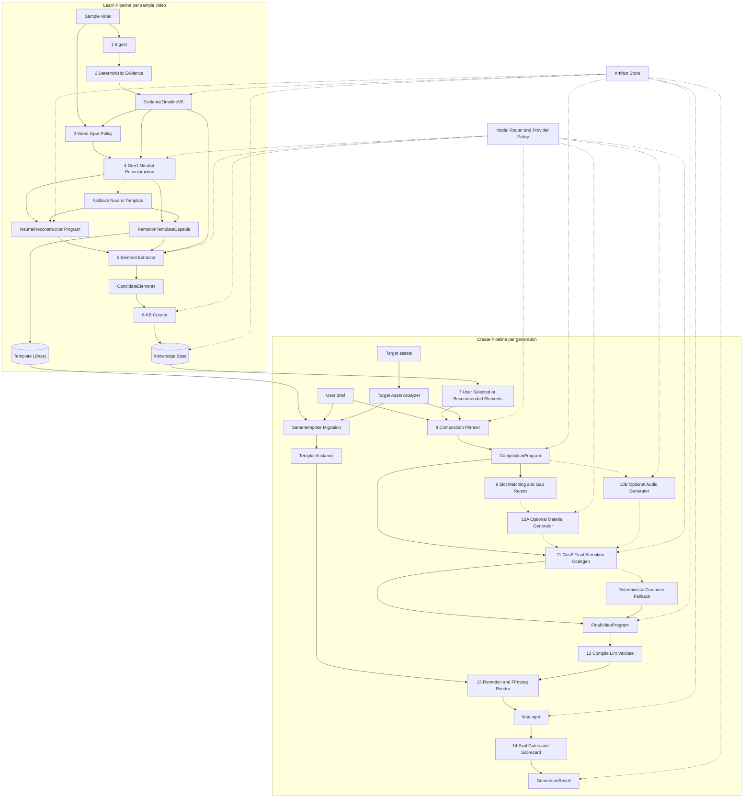

# 02 — Architecture

Current V5.1 implementation has two creation paths:

- **Default path**: learn one sample into a `RemotionTemplateCapsule`, bind ordered target assets and slot assignments, then render a same-template `TemplateInstance`.
- **Advanced path**: extract KnowledgeElements from one or more samples, let the user select or recommend elements, then compose a new structure through the Program-KB/Gen2 route.

## 1. High-level architecture



## 2. Core idea

V5 has a learn side and a create side.

### Learn side

```text
sample video
  -> EvidenceTimelineV5
  -> NeutralReconstructionProgram + RemotionTemplateCapsule
  -> Template Library + KnowledgeElements
```

The learn side converts sample videos into content-neutral, reusable creative knowledge. The template capsule is the Level-1 reusable unit for stable production, while extracted knowledge elements are Level-2 atoms for advanced recomposition.

### Create side

Default:

```text
RemotionTemplateCapsule + ordered target assets + slotAssignments + user brief
  -> TemplateInstance
  -> final.mp4 + TransferTrace + ScorecardV5
```

Advanced:

```text
KB elements + target assets + user brief -> final program -> final.mp4
```

The create side either reuses a learned template safely, or composes selected elements into a new video.

## 3. Main services

### API Server

Responsibilities:

- route HTTP requests
- validate requests
- call pipeline stages
- write and read artifacts
- stream progress to UI

### Artifact Store

Responsibilities:

- store all JSON artifacts atomically
- store media artifacts
- maintain lineage graph
- support replay/debug

### Model Router

Responsibilities:

- select model/provider for each stage
- enforce provider policy
- enforce no-copy restrictions
- apply fallback chain
- record provider decisions

### Knowledge Base

Responsibilities:

- store KnowledgeElements
- dedupe candidates
- support semantic and metadata search
- support user selection
- support auto recommendation
- track provenance and safety

### Template Library

Responsibilities:

- store `RemotionTemplateCapsule` artifacts
- expose template metadata, slot schemas, scene recipes, and validation status
- support same-template migration and slot binding
- keep provenance from sample evidence to generated output

### Renderer

Responsibilities:

- render neutral reconstruction preview
- render final video
- mux audio
- apply FFmpeg fallback operations
- generate preview frames and contact sheets

## 4. Data flow

### Learn artifacts

```text
Asset
EvidenceTimelineV5
NeutralReconstructionProgram
RemotionTemplateCapsule
TemplateSlot[]
TemplateValidation
CandidateElements
KbCurationDecision[]
KnowledgeElement[]
ReconstructionPreview.mp4
```

### Create artifacts

```text
CreativeBrief
TargetAssetProfile[]
SelectionSet
TemplateInstance
CompositionProgram
GapReport
GeneratedAsset[]
AudioPlan
FinalVideoProgram
RenderRecipeV5
TransferTrace
TimelineV2
MappingV2
PackagingPlan
final.mp4
ScorecardV5
```

## 5. Fallback hierarchy

### Gen1 fallback

```text
AI Gen1 neutral program
  -> repair malformed JSON/code
  -> re-ask with simplified schema
  -> deterministic neutral template/capsule from evidence
```

### Same-template fallback

```text
AI slot/context rewrite
  -> deterministic slot binding by user order
  -> generated image/video fallback for missing required slots
  -> procedural title/card fallback
```

### KB curator fallback

```text
hard rule exact duplicate
  -> merge
hard rule unsafe raw sample material
  -> evidence_only
ML judge failure
  -> store as candidate_pending_review or reject_low_confidence
```

### Gen2 fallback

```text
AI final Remotion code
  -> repair code/schema
  -> regenerate only failing component
  -> deterministic compose fallback using built-in components
```

### Audio fallback

```text
user audio
  -> generated audio if enabled
  -> procedural FFmpeg bed/SFX
  -> silence with explicit warning
```

## 6. Why this architecture performs better

1. **Grounded understanding**: deterministic evidence constrains VLM/codegen.
2. **Executable IR**: neutral program can be previewed and validated.
3. **Knowledge reuse**: elements accumulate across videos.
4. **User control**: users can select learned elements.
5. **Stronger gap fill**: KB stores asset/audio generation recipes.
6. **Stable production path**: same-template mode can generate quickly while preserving learned timing and motion.
7. **Creative composition**: Gen2 can blend multiple learned methods into one new program.
8. **Safety**: no sample content enters final video by default.
