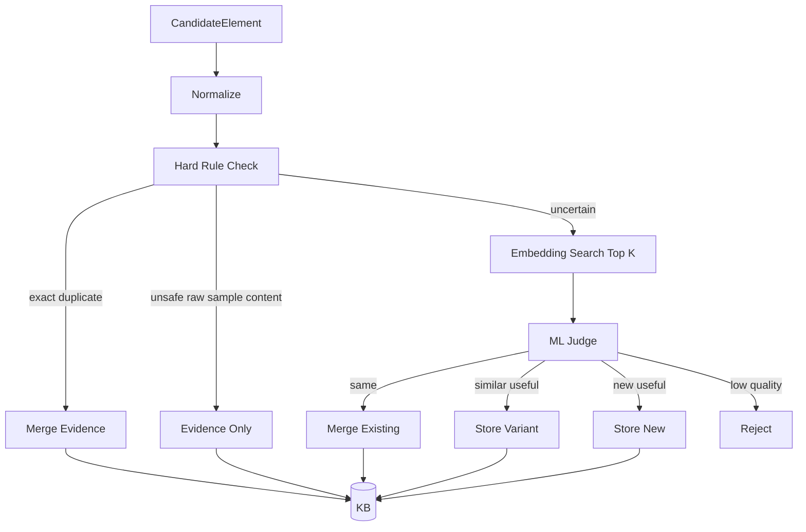

# 05 — Knowledge Base Specification

## 1. Purpose

The Knowledge Base stores reusable creative knowledge learned from sample videos.

It is not a media library of copied sample assets. It is a library of:

- patterns
- recipes
- snippets
- timing grammars
- layout grammars
- audio cue patterns
- generation prompts
- placeholder requirements

## 2. Element types

```ts
type KnowledgeElementKind =
  | "structure_pattern"
  | "hook_pattern"
  | "segment_template"
  | "rhythm_pattern"
  | "motion_pattern"
  | "transition_pattern"
  | "typography_pattern"
  | "layout_pattern"
  | "palette_pattern"
  | "visual_asset_pattern"
  | "image_prompt_recipe"
  | "audio_pattern"
  | "sfx_pattern"
  | "voiceover_pattern"
  | "cta_pattern"
  | "remotion_snippet";
```

## 3. Store policies

### Reusable

Safe abstract element. Can be used directly by Composition Planner.

Examples:

- transition pattern
- subtitle layout rules
- rhythm curve
- Remotion snippet that uses placeholders only

### Regenerate only

The element describes how to recreate something new, but raw sample content cannot be reused.

Examples:

- hero head style
- product hero prompt
- background prompt
- music style prompt

### Evidence only

The candidate is useful for explanation but unsafe or too specific for reuse.

Examples:

- exact sample image crop
- exact logo
- exact subtitle copy
- exact audio track
- watermark

## 4. Curation flow



## 5. Hard rules

Hard rules run before ML because they are cheaper and more reliable.

### Duplicate hard rules

- same `sourceSampleId`, same time range, same kind
- same placeholder id and same usage
- same normalized motion parameters
- same Remotion AST signature
- same prompt hash
- same audio cue sequence
- same OCR hash

### Safety hard rules

- raw image perceptual hash matches sample frame -> `evidence_only`
- raw audio fingerprint matches sample audio -> `evidence_only`
- sample watermark/logo detected -> `evidence_only`
- exact subtitle text copied -> `evidence_only` or sanitized variant

## 6. Embedding search

For uncertain candidates, compute embeddings over:

```text
name
description
kind
tags
payload summary
required slots
style keywords
motion keywords
audio keywords
```

Search top K existing elements.

Recommended thresholds:

```text
similarity >= 0.92 -> likely same
0.78 <= similarity < 0.92 -> possible variant
similarity < 0.78 -> likely new
```

The thresholds are starting defaults and should be tuned with examples.

## 7. ML judge

The ML judge decides:

- is this new?
- is this a duplicate?
- is this a useful variant?
- should it be rejected?
- what should its name be?
- what kind should it be?
- what tags should it have?
- what slots does it require?
- what safety policy applies?

Output is `KbCurationDecision`.

## 8. Element payload examples

### Hook pattern

```json
{
  "kind": "hook_pattern",
  "name": "fast product reveal with impact title",
  "payload": {
    "recommendedDurationSec": 2.0,
    "structure": ["impact open", "hero visual", "large title", "quick benefit"],
    "requiredSlots": ["hero_product", "main_title"],
    "motion": ["scale_in", "micro_shake", "title_pop"],
    "audioCues": ["impact_at_start", "hit_on_title"]
  }
}
```

### Visual asset pattern

```json
{
  "kind": "visual_asset_pattern",
  "name": "premium centered hero head",
  "payload": {
    "observedDescription": {
      "subject": "large centered hero object",
      "lighting": "strong rim light",
      "composition": "centered, fills 55 percent of vertical frame",
      "mood": "premium, dramatic"
    },
    "generationPromptTemplate": "Create a new premium hero object for {targetProduct}. Use centered composition, strong rim light, glossy material, and dramatic dark background. Do not copy the source sample.",
    "negativePrompt": "no watermark, no sample logo, no exact original face, no original text"
  },
  "safety": {
    "reusablePolicy": "regenerate_only"
  }
}
```

### Audio pattern

```json
{
  "kind": "audio_pattern",
  "name": "fast electronic commercial hook beat",
  "payload": {
    "bpm": 128,
    "mood": ["energetic", "commercial", "clean"],
    "cuePoints": [
      { "t": 0.0, "type": "impact", "role": "hook_start" },
      { "t": 1.2, "type": "hit", "role": "title_pop" },
      { "t": 12.0, "type": "impact", "role": "cta" }
    ],
    "generationPromptTemplate": "Generate a fast electronic commercial beat around 128 BPM with clean synth bass, punchy kick, risers before transitions, and strong impacts at hook and CTA. Do not imitate the source track."
  },
  "safety": {
    "reusablePolicy": "regenerate_only"
  }
}
```

## 9. Retrieval and recommendation

### Manual selection

User browses elements by:

- type
- source sample
- tag
- vertical
- aspect ratio
- quality score
- preview

### Auto recommendation

Input:

```ts
CreativeBrief
TargetAssetProfile[]
VariantGoal
```

Return:

```ts
RecommendedElement[]
```

Recommendation should balance:

- relevance to brief
- compatibility with assets
- diversity across source samples
- coherence risk
- quality/usefulness score
- no-copy safety

## 10. Coherence constraints

Each KnowledgeElement should declare:

```ts
compatibility: {
  aspectRatios: string[];
  verticals: string[];
  canCombineWith: string[];
  conflictsWith: string[];
  styleTags: string[];
  pacingTags: string[];
}
```

Composition Planner must use this to avoid messy combinations.
