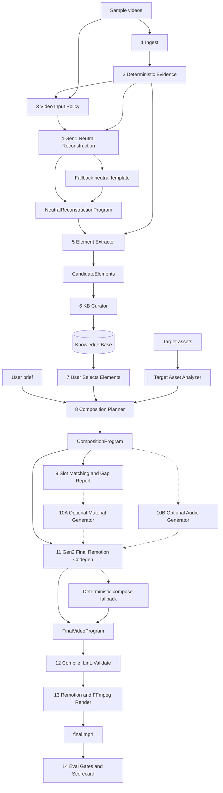

# Spec v5.0 — Program-KB Dual Codegen Creative Engine

## 0. One-line goal

Build a system that learns reusable creative methods from many sample videos, stores them as safe knowledge elements, lets the user select and combine those elements, then generates a brand-new Remotion video program and renders a final short video.

Short form:

```text
sample videos -> evidence -> neutral reconstruction programs -> knowledge elements -> KB
KB + user selected elements + target assets -> composition program -> final Remotion code -> final.mp4
```

Core rule:

```text
Learn structure and creative method. Do not copy original sample content.
```

---

## 1. Why v5 changes v4

v4 is good at evidence, atoms, gap reports, and layer-based RenderRecipe. The main weakness is that the best visual codegen path is still too late and too optional. v5 promotes codegen into two clearly separated jobs:

1. **Gen1: Neutral Reconstruction Synthesizer**
   - Input: one sample video + deterministic evidence.
   - Output: typed neutral program + Remotion reconstruction code + placeholders.
   - Purpose: understand the sample and convert it into a safe, analyzable program.

2. **Gen2: Final Composition Codegen**
   - Input: selected KB elements + target assets + user brief + composition plan.
   - Output: final Remotion project/code + RenderRecipe.
   - Purpose: create a new video by recombining learned methods from many videos.

v5 keeps v4's useful parts:

- deterministic evidence backbone
- evidenceRefs everywhere
- gap report
- layer-based RenderRecipe
- model router and fallback policy
- no sample pixel/audio in final video
- UI must show the transfer chain

v5 adds:

- neutral reconstruction program as the central learn-side IR
- multi-video knowledge base as the central product asset
- hard-rule + ML KB curator
- asset and audio recipe learning, not only structural atom learning
- user-selected multi-video element composition
- final Remotion codegen as the high-quality render path
- deterministic compose fallback if Gen2 fails

---

## 2. Top-level architecture



---

## 3. Two pipelines

### 3.1 Learn pipeline

Run once per source video.

```text
POST /api/learn-samples
  -> ingest sample video
  -> deterministic evidence
  -> Gen1 neutral reconstruction
  -> validate reconstruction structure
  -> extract candidate elements
  -> curate KB
  -> write learned program + elements + previews
```

Output artifacts:

```text
analysis.json
neutral-reconstruction-program.json
reconstruction-remotion/
reconstruction-preview.mp4
candidate-elements.json
kb-decisions.json
knowledge-elements.json
learn-scorecard.json
```

### 3.2 Create pipeline

Run once per new video request.

```text
POST /api/generations
  -> retrieve or user-select KB elements
  -> analyze target assets
  -> composition planner
  -> slot matching and gap report
  -> optional material fill
  -> optional audio fill
  -> Gen2 final Remotion codegen
  -> compile and render
  -> eval gates and UI reports
```

Output artifacts:

```text
selected-elements.json
composition-program.json
gap-report.json
generated-assets.json
audio-plan.json
final-video-program.json
render-recipe.json
final.remotion.mp4
final.mp4
scorecard.json
```

---

## 4. Stage specs

### 4.1 Stage 1: Ingest

Input:

```ts
type IngestInput = {
  projectId: string;
  assets: Array<{
    filePath: string;
    role: "sample" | "target" | "reference";
    sourcePolicy: "sample_evidence" | "user_uploaded" | "generated";
    mimeType: string;
  }>;
};
```

Rules:

- sample video is evidence only
- target assets may be renderable
- no raw prompt displayed directly
- every asset gets provenance

---

### 4.2 Stage 2: Deterministic Evidence

Purpose: produce reliable facts before any VLM interpretation.

Tools:

```text
ffprobe
PySceneDetect
OpenCV optical flow
frame diff heuristics
OCR hints
ASR hints
librosa or FFmpeg audio filters
contact sheets
```

Output:

```ts
type EvidenceTimelineV5 = {
  id: string;
  sampleId: string;
  meta: {
    durationSec: number;
    fps: number;
    width: number;
    height: number;
    aspectRatio: string;
    hasAudio: boolean;
  };
  shots: ShotEvidence[];
  frameSheets: FrameSheetRefs;
  visualTracks: VisualTrackEvidence[];
  typographyEvidence: TypographyEvidence[];
  motionEvidence: MotionEvidence[];
  rhythm: RhythmEvidence;
  audio: AudioEvidence;
  emptyReasons: Array<{ kind: string; reason: string }>;
  safety: {
    sampleFrameCopyAllowed: false;
    sampleAudioCopyAllowed: false;
  };
};
```

Important rule:

```text
The original video and deterministic evidence both go into Gen1.
```

The VLM should not analyze the raw video alone.

---

### 4.3 Stage 3: Video Input Policy

Purpose: decide how Gen1 sees the sample video.

Default policy:

```text
short video under about 60s -> whole-video global pass
fast motion or MG -> whole-video global pass + scene-aware detail clips
long video -> low-fps global pass + scene-aware chunks
```

Recommended defaults:

```ts
type VideoInputPolicy = {
  globalPass: {
    useWholeVideo: true;
    fps: 2 | 3 | 5;
  };
  detailPass?: {
    enabled: boolean;
    chunkMode: "scene_aware" | "beat_window";
    overlapSec: number;
    fps: 5 | 8;
  };
};
```

Do not default to blind 8-second chunks. Chunk only when evidence says detail is needed.

---

### 4.4 Stage 4: Gen1 Neutral Reconstruction Synthesizer

Purpose: convert a sample video into a content-neutral program.

Input:

```text
original sample video
deterministic evidence
contact sheets
strict output schema
safety policy
```

Output:

```ts
type NeutralReconstructionProgram = {
  id: string;
  sourceSampleId: string;
  evidenceRefs: string[];

  typedSpec: RenderProgramSpecV5;

  remotionProject: {
    entryFile: string;
    componentName: string;
    files: Array<{ path: string; content: string }>;
    propsSchema: unknown;
    fixture: unknown;
  };

  placeholders: PlaceholderSlot[];
  timingMap: TimingSegment[];

  learnedAssetRecipes: AssetRecipe[];
  learnedAudioRecipes: AudioRecipe[];

  reconstructionQuality: {
    structureCoverage: number;
    timingCoverage: number;
    placeholderCoverage: number;
    warnings: string[];
  };

  safety: {
    samplePixelsRemoved: boolean;
    sampleTextSanitized: boolean;
    sampleAudioRemoved: boolean;
    renderableSampleMaterialRefs: string[];
  };
};
```

Critical rule:

```text
Neutral reconstruction means same creative grammar, not same content.
```

Allowed:

```text
same timing logic
same layout grammar
same motion grammar
same text style
same transition idea
same audio cue pattern
```

Not allowed:

```text
original logo
original face/head image
original subtitle text
original music/audio track
original watermark
sample frame as final material
```

---

### 4.5 Stage 5: Element Extractor

Purpose: extract reusable candidate elements from the neutral program.

This can use a lighter text model because the input is already structured JSON + sanitized code.

Input:

```text
NeutralReconstructionProgram.typedSpec
placeholders
timingMap
learnedAssetRecipes
learnedAudioRecipes
evidence summary
```

Output:

```ts
type CandidateElement = {
  id: string;
  proposedName: string;
  kind: KnowledgeElementKind;
  sourceProgramId: string;
  sourceSampleId: string;
  evidenceRefs: string[];
  summary: string;
  reusablePolicy: "direct_reuse" | "parametric_reuse" | "regenerate_only" | "evidence_only";
  slots: PlaceholderSlot[];
  remotionSnippet?: RemotionSnippetRef;
  assetRecipe?: AssetRecipe;
  audioRecipe?: AudioRecipe;
  qualityHints: string[];
};
```

Element kinds:

```ts
type KnowledgeElementKind =
  | "structure_pattern"
  | "hook_pattern"
  | "segment_template"
  | "rhythm_pattern"
  | "motion_pattern"
  | "transition_pattern"
  | "typography_pattern"
  | "layout_pattern"
  | "palette_pattern"
  | "visual_asset_pattern"
  | "image_prompt_recipe"
  | "audio_pattern"
  | "sfx_pattern"
  | "voiceover_pattern"
  | "cta_pattern"
  | "remotion_snippet";
```

---

### 4.6 Stage 6: KB Curator

Purpose: keep the knowledge base useful, clean, safe, and non-duplicated.

Flow:

```text
CandidateElement
  -> normalize
  -> hard-rule dedupe
  -> if uncertain, embedding search
  -> if still uncertain, ML judge
  -> store / merge / variant / reject / evidence_only
```

Hard rules:

```text
same sourceSampleId + same time range + same kind -> likely duplicate
same normalized motion params -> duplicate or variant
same OCR text hash -> not reusable, maybe evidence_only
same image pHash -> raw sample image, evidence_only
same audio fingerprint -> raw sample audio, evidence_only
same Remotion AST signature -> duplicate or variant
same generation prompt hash -> duplicate or variant
```

ML judge output:

```ts
type KbDecision =
  | { action: "store_new"; name: string; kind: KnowledgeElementKind; reason: string }
  | { action: "merge_existing"; existingElementId: string; reason: string }
  | { action: "store_variant"; parentElementId: string; variantName: string; reason: string }
  | { action: "reject"; reason: string }
  | { action: "evidence_only"; reason: string };
```

Knowledge element:

```ts
type KnowledgeElement = {
  id: string;
  kind: KnowledgeElementKind;
  name: string;
  description: string;
  tags: string[];

  source: {
    sourceSampleId: string;
    sourceProgramId: string;
    evidenceRefs: string[];
    sourceTimeRangeSec?: [number, number];
  };

  reusablePolicy: "parametric_reuse" | "regenerate_only" | "evidence_only";

  slots: PlaceholderSlot[];

  style: {
    palette?: string[];
    typography?: string;
    mood?: string[];
    pacing?: "slow" | "medium" | "fast";
  };

  remotion?: {
    snippetRef?: string;
    propsSchemaRef?: string;
    allowedImports: string[];
  };

  assetRecipe?: AssetRecipe;
  audioRecipe?: AudioRecipe;

  compatibility: {
    aspectRatios: string[];
    verticals: string[];
    canCombineWith: string[];
    conflictsWith: string[];
  };

  safety: {
    noCopyChecked: boolean;
    samplePixelsRemoved: boolean;
    sampleAudioRemoved: boolean;
    sampleTextRemoved: boolean;
    renderable: boolean;
  };

  preview: {
    thumbnail?: string;
    previewMp4?: string;
  };

  quality: {
    confidence: number;
    usefulness: number;
    visualImpact: number;
    reuseCount: number;
  };
};
```

---

### 4.7 AssetRecipe and AudioRecipe

v5 learns more than structure. It also learns how to regenerate missing visual and audio assets.

Raw sample image/audio is evidence only. The reusable part is the recipe.

```ts
type AssetRecipe = {
  id: string;
  kind:
    | "hero_head"
    | "hero_product"
    | "background"
    | "cover"
    | "product_card"
    | "sticker"
    | "logo_placeholder"
    | "comparison_card";

  observedDescription: {
    subject: string;
    shape?: string;
    material?: string;
    lighting?: string;
    camera?: string;
    composition?: string;
    mood?: string;
  };

  generationPromptTemplate: string;
  negativePrompt: string;

  placementHint: {
    sectionRole: "hook" | "setup" | "proof" | "cta";
    bboxNorm?: { x: number; y: number; w: number; h: number };
    motion?: string;
    durationSec?: number;
  };

  reusablePolicy: "regenerate_only" | "evidence_only";
};
```

```ts
type AudioRecipe = {
  id: string;
  kind: "music_bed" | "impact" | "whoosh" | "riser" | "voiceover_style" | "ducking_pattern";
  bpm?: number;
  mood: string[];
  instruments?: string[];
  energyCurve?: Array<{ t: number; value: number }>;
  cuePoints: Array<{ t: number; type: "hit" | "riser" | "impact" | "duck"; role: string }>;
  generationPromptTemplate: string;
  negativePrompt: string;
  reusablePolicy: "regenerate_only" | "procedural_recreate" | "evidence_only";
};
```

---

### 4.8 Stage 7: KB UI and selection

The user can:

```text
search elements
filter by type
preview learned elements
select elements from multiple videos
ask system to recommend a set
lock or remove an element
choose version: high_click, high_conversion, high_quality
```

Selection output:

```ts
type SelectedElementSet = {
  id: string;
  selected: Array<{
    elementId: string;
    reason: string;
    locked: boolean;
    targetRole?: "hook" | "proof" | "transition" | "cta" | "audio";
  }>;
  userBrief: CreativeBrief;
};
```

---

### 4.9 Stage 8: Composition Planner

Purpose: plan a coherent new video before codegen.

Important:

```text
Composition Planner outputs JSON, not final Remotion code.
```

Input:

```text
selected elements
target asset profiles
user brief
variant goal
safety policy
```

Output:

```ts
type CompositionProgram = {
  id: string;
  creativeBrief: CreativeBrief;
  selectedElements: Array<{ elementId: string; appliedRole: string }>;

  composition: {
    width: number;
    height: number;
    fps: number;
    durationSec: number;
    aspectRatio: string;
  };

  sections: Array<{
    id: string;
    role: "hook" | "setup" | "proof" | "demo" | "benefit" | "transition" | "cta";
    startSec: number;
    endSec: number;
    purpose: string;
    elementRefs: string[];
    requiredSlots: string[];
  }>;

  stylePlan: {
    palette: string[];
    typographySystem: string;
    motionIntensity: "low" | "medium" | "high";
    textDensity: "low" | "medium" | "high";
    pacing: "slow" | "medium" | "fast";
    coherenceNotes: string[];
  };

  slotPlan: SlotPlan[];
  materialPlan: MaterialPlan;
  audioPlan: AudioPlan;

  explanation: {
    howElementsCombine: string[];
    whyThisStructureFitsBrief: string;
    possibleRisks: string[];
  };
};
```

Planner responsibility:

```text
make selected elements work together
harmonize palette, typography, pacing, and motion
avoid Frankenstein results
label missing slots
choose fallback strategy
```

---

### 4.10 Stage 9: Slot Matching and Gap Report

Same idea as v4, but now slots come from:

```text
CompositionProgram sections
KnowledgeElement slots
AssetRecipe placement hints
AudioRecipe cue points
```

Output:

```ts
type GapReportV5 = {
  gaps: Array<{
    id: string;
    slotId: string;
    sourceElementId?: string;
    status: "matched" | "weak_match" | "missing";
    required: string;
    matchedAssetIds: string[];
    reason: string;
    impact: "low" | "medium" | "high";
    selectedRepair: "asset_reuse" | "text_fill" | "packaging_fill" | "aigc_fill" | "procedural_fill" | "structure_reorder";
    expectedVisualOrAudioResult: string;
  }>;
};
```

---

### 4.11 Stage 10A: Optional Material Generator

Input:

```text
GapReport missing visual slots
AssetRecipe from KB
target product info
target assets
```

Output:

```ts
type GeneratedVisualAsset = {
  id: string;
  kind: "image" | "video" | "poster" | "card" | "background";
  uri: string;
  provenance: {
    source: "aigc_generated" | "procedural" | "target_asset_reuse";
    promptHash?: string;
    sourceElementIds: string[];
    samplePixelsUsed: false;
  };
  usageHint: string;
};
```

Fallback:

```text
Remotion shape card
text card
crop target asset
zoom target asset
procedural background
```

---

### 4.12 Stage 10B: Optional Audio Generator

Input:

```text
CompositionProgram.audioPlan
AudioRecipe from KB
target voiceover text
render duration
```

Output:

```ts
type GeneratedAudioAsset = {
  id: string;
  kind: "music" | "voiceover" | "sfx" | "procedural_mix";
  uri?: string;
  audioLayer: AudioLayer;
  provenance: {
    source: "aigc_generated" | "procedural" | "user_audio";
    sourceElementIds: string[];
    sampleAudioUsed: false;
  };
};
```

Fallback:

```text
FFmpeg procedural bed
sine hit
noise whoosh
riser by filtered noise
silence with warning only if all else fails
```

---

### 4.13 Stage 11: Gen2 Final Remotion Codegen

Purpose: create the final new Remotion project.

Input:

```text
CompositionProgram
selected KnowledgeElements
target assets
generated assets
generated audio
safety policy
allowed component library
```

Output:

```ts
type FinalVideoProgram = {
  id: string;

  remotionProject: {
    entryFile: string;
    componentName: string;
    files: Array<{ path: string; content: string }>;
    propsSchema: unknown;
    fixture: unknown;
  };

  renderRecipe: RenderRecipeV5;

  explanation: {
    usedElements: Array<{
      elementId: string;
      sourceSampleId: string;
      appliedAtSec: number;
      reason: string;
    }>;
    gapFillDecisions: string[];
    audioDecisions: string[];
  };

  validation: {
    schemaPassed: boolean;
    tsCompilePassed: boolean;
    noCopyPassed: boolean;
    warnings: string[];
  };
};
```

Gen2 must not see raw sample videos unless explicitly in a read-only evidence view. It only needs KB elements and recipes.

Fallback:

```text
deterministic compose fallback
  -> use selected elements as layer presets
  -> compile RenderRecipe
  -> render with built-in Remotion components
```

---

### 4.14 Stage 12: Compile, Lint, Validate

Checks:

```text
TypeScript compile
schema validation
allowed import list
no sample asset path in final code
no sample audio path
no raw prompt rendered
no watermark reuse
all layers have evidenceRefs or fallbackReason
all generated assets have provenance
```

---

### 4.15 Stage 13: Render

Renderer path:

```text
Remotion renders final.remotion.mp4
FFmpeg muxes final.mp4
FFmpeg audio mix fallback available
```

Renderer input should be:

```text
FinalVideoProgram.remotionProject
RenderRecipeV5
renderable target/generated assets only
```

---

### 4.16 Stage 14: Eval Gates and Scorecard

Required gates:

```text
V5-G1 evidence exists
V5-G2 Gen1 neutral program exists or fallback exists
V5-G3 no sample pixels renderable
V5-G4 no sample audio renderable
V5-G5 candidate elements extracted
V5-G6 KB curator decision recorded
V5-G7 user selected or system recommended elements recorded
V5-G8 CompositionProgram exists
V5-G9 GapReport explains missing slots
V5-G10 material fill provenance recorded if used
V5-G11 audio plan exists or explicit empty reason exists
V5-G12 Gen2 output exists or compose fallback exists
V5-G13 TypeScript compile passed
V5-G14 schema validation passed
V5-G15 final.mp4 exists
V5-G16 audio not silent unless explicitly intended
V5-G17 no long blank visual sections
V5-G18 structure mapping visible
V5-G19 coherence score recorded
V5-G20 scorecard covers rubric
```

Quality gates:

```text
structure fidelity: learned elements match evidence
composition coherence: selected elements look like one video
render quality: no blank sections, no unreadable text, audio present
rubric coverage: sample parse, structure, gap, fill, visualization, final result
```

---

## 5. Safety policy

### 5.1 Sample media policy

```text
Sample raw frames: evidence only
Sample crops: evidence preview only
Sample audio: evidence only
Sample text: sanitized summary only
Sample logo/face/character: evidence only
```

### 5.2 Reusable content policy

Reusable:

```text
motion grammar
layout grammar
typography style
timing pattern
audio cue pattern
image generation prompt template
Remotion component using placeholders
```

Not reusable:

```text
sample pixel asset
sample audio track
sample brand/logo
sample exact subtitle copy
sample watermark
```

---

## 6. UI spec

Minimum tabs:

```text
1 Analyze
2 Reconstruct
3 Extract
4 Knowledge Base
5 Select
6 Plan
7 Fill
8 Render
9 Evaluate
```

### Analyze tab

Show:

```text
video preview
metadata
shot timeline
contact sheet
OCR/ASR table
beat grid
energy curve
motion graph
audio summary
```

### Reconstruct tab

Show:

```text
original sample
neutral reconstruction preview
placeholder list
timing map
reconstruction warnings
evidence refs
```

### Extract tab

Show:

```text
candidate elements
source timestamps
kind
preview
reusable policy
asset/audio recipe
```

### Knowledge Base tab

Show:

```text
stored elements
merge/variant graph
hard rule decision
ML judge decision
search/filter
preview
```

### Select tab

Show:

```text
user chosen hook / transition / subtitle / CTA / audio / visual asset recipe
auto-recommend options
lock/remove buttons
```

### Plan tab

Show:

```text
CompositionProgram timeline
selected element mapping
slot plan
gap report
style harmonization notes
```

### Fill tab

Show:

```text
missing visual slots
generated image prompts
generated images/cards/backgrounds
music/SFX/voiceover plan
provenance
```

### Render tab

Show:

```text
final video
preview frames
layer timeline
recipe inspector
compile warnings
```

### Evaluate tab

Show:

```text
sample vs reconstruction vs final
structure mapping
no-copy gate
audio gate
rubric scorecard
```

---

## 7. API spec

```text
POST /api/projects
POST /api/assets
POST /api/learn-samples
GET  /api/samples/:id/evidence
GET  /api/samples/:id/reconstruction
GET  /api/kb/elements
POST /api/kb/curate
POST /api/kb/search
POST /api/generations/plan
POST /api/generations
POST /api/generations/:id/render
POST /api/generations/:id/revise
GET  /api/generations/:id/scorecard
```

Main request:

```ts
type GenerationRequestV5 = {
  projectId: string;
  brief: CreativeBrief;
  targetAssetIds: string[];
  selectedElementIds?: string[];
  autoRecommend?: boolean;
  variant?: "high_click" | "high_conversion" | "high_quality";
  options: {
    materialFill: "off" | "local" | "aigc";
    audioFill: "off" | "procedural" | "aigc";
    finalCodegen: "on" | "off";
    fallbackRender: true;
  };
};
```

---

## 8. Recommended repo shape

```text
apps/api/src/pipeline-v5/
  runLearnSample.ts
  runEvidence.ts
  runGen1NeutralReconstruction.ts
  runExtractElements.ts
  runKbCurator.ts
  runTargetAssetAnalysis.ts
  runCompositionPlanner.ts
  runGapReport.ts
  runMaterialFill.ts
  runAudioFill.ts
  runGen2FinalCodegen.ts
  runCompileValidate.ts
  runRender.ts
  runEvaluate.ts

apps/api/src/services/
  artifactStore.ts
  knowledgeBase.ts
  modelRouter.ts
  providerPolicy.ts
  safetyPolicy.ts

packages/shared/src/contracts-v5/
  evidence.ts
  neutralProgram.ts
  knowledgeElement.ts
  compositionProgram.ts
  finalVideoProgram.ts
  renderRecipe.ts
  scorecard.ts

apps/api/remotion/
  V5FinalRoot.tsx
  V5ReconstructionRoot.tsx
  components/
    LayerRenderer.tsx
    TextRenderer.tsx
    MotionRenderer.tsx
    AudioDebugOverlay.tsx
```

---

## 9. Priority plan

### P0

```text
EvidenceTimelineV5
Gen1 neutral program with placeholders
Element extractor
KB store with hard-rule dedupe
Composition planner JSON
Gen2 final Remotion codegen
compile + schema + no-copy gates
render final.mp4
UI: Analyze, KB, Plan, Render, Evaluate
```

### P1

```text
ML KB judge
asset recipes
material filler
basic audio recipes
procedural audio fallback
coherence gate
multi-version generation
```

### P2

```text
advanced visual/audio AIGC providers
drag-and-drop element timeline
natural language editing
auto recommendation engine
multi-video style blender
A/B score prediction
```

---

## 10. Final mental model

v5 is not a template renderer.

v5 is:

```text
A creative method learning engine
+ a reusable knowledge base
+ a program composer
+ a Remotion code generator
+ a renderer and proof UI
```

The best demo story:

```text
We learned hook from sample A.
We learned subtitle rhythm from sample B.
We learned CTA card from sample C.
We learned music cue pattern from sample D.
We selected them from the KB.
The planner combined them into one coherent new video.
Gen2 wrote a new Remotion project.
The final video uses only target/generated material, not sample content.
```
